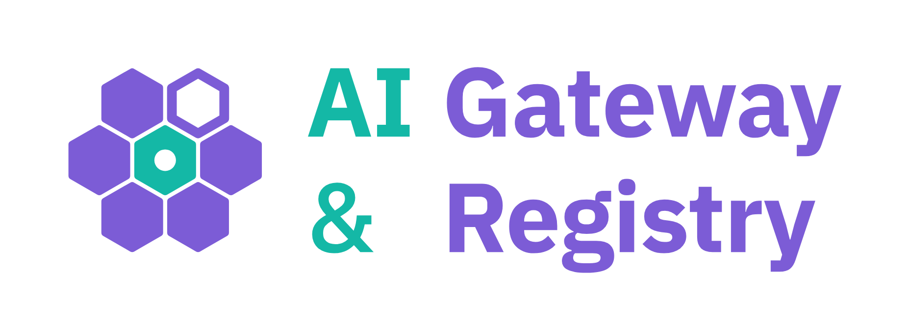
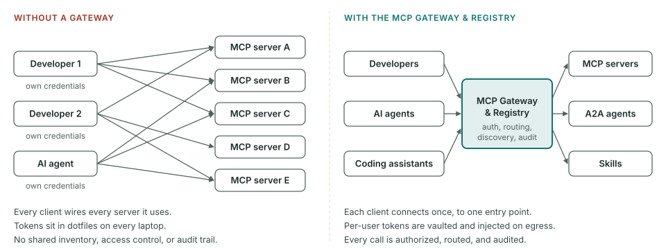
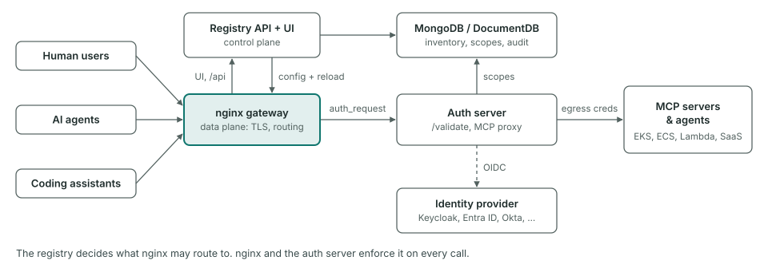

<!-- Budget: 350 lines max (CI-enforced). Feature announcements -> docs/overview/feature-release-highlights.md (top 3 mirrored here). Structure rationale -> docs/design/theory-of-the-system.md#6-how-to-change-this-system-without-breaking-its-theory -->
<div align="center">
<picture>
  <source media="(prefers-color-scheme: dark)" srcset="docs/logo/png/lockup-horizontal-on-dark.png">
  <source media="(prefers-color-scheme: light)" srcset="docs/logo/png/lockup-horizontal-on-light.png">
  
</picture>

**Unified Agent & MCP Server Registry – Gateway for AI Development Tools**

[](https://github.com/agentic-community/mcp-gateway-registry/stargazers)
[](https://github.com/agentic-community/mcp-gateway-registry/network)
[](LICENSE)
[](https://github.com/agentic-community/mcp-gateway-registry/releases)

[Get Running Now](#quick-start) | [Docs](https://agentic-community.github.io/mcp-gateway-registry/) | [Executive Brief](docs/overview/executive-brief.md) | [Slide Deck](docs/slides/mcp-gateway-registry-presentation.pdf) | [Demo Videos](docs/demo-videos.md) | [AWS Workshop](https://catalog.us-east-1.prod.workshops.aws/workshops/0c3265a6-1a4a-467b-ae56-e4d019184b0e/en-US) | [Community](#community)

If your organization runs the MCP Gateway & Registry in production, please [add it to ADOPTERS.md](ADOPTERS.md). It takes about five minutes.

</div>

---

The **MCP Gateway & Registry** is a single, governed control plane for every AI asset in your organization, from MCP servers and AI agents to skills and any custom asset your teams build. It is open source, licensed under Apache 2.0, and runs on Kubernetes (Amazon EKS), fully managed serverless (Amazon ECS), or Docker Compose (Amazon EC2).

It began as a gateway and registry for the [Model Context Protocol (MCP)](https://modelcontextprotocol.io/introduction): one secure entry point to many MCP servers, with centralized discovery and governance. As teams started registering agents, skills, and other assets alongside their servers, it grew into a general-purpose **AI asset registry** on the same gateway, access-control, and audit model it started with.

## Why we built this

Without a control plane, every team wires its own MCP servers and agents by hand: separate credentials in every dotfile, no shared inventory, no audit trail, and no way to discover or govern what exists. Agents can't find other agents; servers and agents live in separate registries that can't share policy.

This platform replaces that with **one governed entry point for every AI asset**. Register a server, agent, skill, or custom entity once; discover it by natural-language search; reach it through a single authenticated gateway that enforces access and records every call. One control plane, one access model, one audit trail, across all asset types.

<p align="center">
  
</p>

**Onboard third-party OAuth MCP servers, the enterprise way.** Because the gateway provides [per-user egress authentication](docs/design/egress-auth-design.md), you can connect OAuth-protected SaaS MCP servers such as Slack, Atlassian, and GitHub without every user setting up network access to those services or storing credentials on their laptop. Each user connects their account once; the gateway runs the OAuth (3LO) flow, vaults the per-user token in a secrets manager, and injects it on egress. That collapses onboarding to a single, auditable choke point, so a team can adopt a new SaaS MCP server across the enterprise without per-laptop plumbing or scattered long-lived tokens.

## How it works

The gateway is the **data plane** (a generic nginx reverse proxy: TLS, auth validation, routing to backends) and the registry is the **control plane** (a FastAPI service that owns the inventory, access model, and audit trail, and decides what the gateway may route to). An **auth server** integrates your identity provider (Keycloak, Entra ID, Okta, Auth0, Cognito, PingFederate) for OAuth2/OIDC, and **MongoDB / DocumentDB** stores configuration, embeddings, sessions, and audit records.

<p align="center">
  
</p>

By default, the registry handles A2A discovery, authentication, and access control, and agents then communicate directly (peer-to-peer) rather than routing every call through the gateway. For the full design and its invariants, read the [Theory of the System](docs/design/theory-of-the-system.md); for layered diagrams, see [Architecture Diagrams](docs/architecture-diagrams.md).

## See it in action

Watch how MCP servers, A2A agents, and external registries work together for dynamic tool discovery:

https://github.com/user-attachments/assets/97c640db-f78b-4a6c-9662-894f975f66e2

More walkthroughs are in the [demo videos](docs/demo-videos.md).

## Start here if you are a...

| You are a... | Start here |
|---|---|
| **Developer** | Start with the [Complete Setup Guide](docs/complete-setup-guide.md); you can also try the [macOS setup skill](.claude/skills/macos-setup/SKILL.md) to get it running on your MacBook. Then connect your AI coding assistant with the [AI Coding Assistant Integration guide](docs/ai-coding-assistants-setup.md). For programmatic access, see the [OpenAPI spec](api/openapi.json) plus a Python registration client ([`registry_client.py`](api/registry_client.py)) and CLI ([`registry_management.py`](api/registry_management.py)). |
| **Platform / security / ops team** | See the deployment guides for [Amazon EKS (Helm)](charts/README.md), [Amazon ECS (Terraform)](terraform/aws-ecs/README.md), and [Docker Compose](docs/installation.md); the [authentication guide](docs/auth.md); the [configuration reference](docs/configuration.md); and [access control & scopes](docs/scopes.md). |
| **Decision-maker evaluating adoption** | Read the [Executive Brief](docs/overview/executive-brief.md), watch the [demo videos](docs/demo-videos.md), and try the [AWS Workshop](https://catalog.us-east-1.prod.workshops.aws/workshops/0c3265a6-1a4a-467b-ae56-e4d019184b0e/en-US). |

## Quick Start

The fastest path is the pre-built Docker images. Clone, set a few secrets, and run:

```bash
git clone https://github.com/agentic-community/mcp-gateway-registry.git
cd mcp-gateway-registry
cp .env.example .env

# Edit .env and set the required secrets (e.g. KEYCLOAK_ADMIN_PASSWORD, SECRET_KEY).
# See docs/configuration.md for the full list.
nano .env

# Deploy with pre-built images (pulled from Amazon ECR Public by default)
./build_and_run.sh --prebuilt

# Open the Registry UI (served by nginx on port 80)
open http://localhost        # macOS  (Linux: xdg-open http://localhost)
```

The [Complete Installation Guide](docs/installation.md) has the full walkthrough for **Amazon EC2** (prerequisites, MongoDB and Keycloak initialization, first user and service account, registering a server, and testing the gateway).

**Deploying somewhere else?**

- **Amazon ECS**: see the [Terraform stack README](terraform/aws-ecs/README.md), or better, use the [Terraform setup skill](.claude/skills/terraform-setup/SKILL.md) to have your AI coding assistant run the deployment for you.
- **Amazon EKS**: see the [Helm charts](charts/README.md).
- **Just want to try it on macOS?**: use the [macOS setup skill](.claude/skills/macos-setup/SKILL.md) to get it running on your MacBook end to end.

## What's in the box

The registry holds four built-in asset types plus admin-defined custom ones, all on one control plane:

- **MCP servers**: register, discover, and govern access to MCP servers behind a single authenticated gateway.
- **Agents (A2A)**: register agents and let them discover each other by capability; by default agent-to-agent traffic runs peer-to-peer.
- **Skills**: register, version, and discover reusable `SKILL.md` skills, with security scanning at registration.
- **Custom entities**: admins define their own schema-driven entity types (n8n workflows, policies, prompt templates, model cards, and more); see [Custom Entity Types](docs/custom-entities.md).

Across all of them you get semantic + lexical search, UI, REST, and MCP-native interfaces, and uniform governance. Key features worth calling out:

- **[Use it as an AI gateway for anything HTTP](docs/gateway-proxy-operational-guide.md)**: one authenticated entry point in front of **model inference** (OpenAI, Amazon Bedrock, any OpenAI-compatible endpoint), **MCP servers**, **A2A agents**, and **any generic REST endpoint**. Callers hold a gateway token; the backend URL and its credential stay in the registry, encrypted at rest and injected at egress, with per-entity streaming and the same scopes, audit, and rate limits as everything else. Off by default. [Design](docs/design/gateway-generic-proxy.md) · [FAQ: OpenAI and Bedrock](docs/faq/registering-model-inference-endpoints.md)
- **Single authenticated gateway**: one entry point; OAuth against your existing IdP (Keycloak, Entra ID, Okta, Auth0, Cognito, PingFederate) with fine-grained [scopes](docs/scopes.md).
- **Dynamic tool discovery**: agents and coding assistants find tools at runtime by natural-language [semantic search](docs/dynamic-tool-discovery.md), not hard-coded config.
- **[Virtual MCP servers](docs/design/virtual-mcp-server.md)**: aggregate tools from many backends behind one endpoint, with per-tool access control.
- **[Per-user egress auth (3LO / OBO / PAT)](docs/design/egress-auth-design.md)**: the gateway brokers third-party SaaS credentials so tokens never live on a user's laptop.
- **Security scanning + [fail-closed admission gate](docs/registration-webhooks.md)**: every registered server, agent, and skill is scanned; unsafe items are held for review.
- **[External-registry federation](docs/federation.md)**: pull in Anthropic's MCP Registry, AWS Agent Registry, and peer registries for one unified surface.
- **[Audit logging](docs/audit-logging.md)**: a full, attributable audit trail of access and admin events, with credential masking, for compliance and incident review.
- **Observability**: [OpenTelemetry metrics](docs/OBSERVABILITY.md) and health monitoring built in.

## What's New
<!-- Exactly the 5 most-recent highlights. Older entries live in docs/overview/feature-release-highlights.md; the release-notes skill rotates this list. Do not grow it. -->
- **MCP 2026-07-28 Support** - The gateway serves MCP 2026-07-28 clients, which send no `initialize` and no session id, and clients of earlier revisions on the same URLs. Virtual servers answer `server/discover` and bridge a 2026-07-28 client to handshake-era backends, and nginx rejects a request whose `Mcp-Method` or `Mcp-Name` header disagrees with its body. Tool discovery, the health check, the security scanner and mcpgw move to MCP SDK 2.x. A scope with `tools: ["*"]` now grants tools only, so check custom scopes that relied on it for other methods before upgrading. See the [1.37.0 release notes](docs/release-notes/1.37.0.md) and [MCP 2026-07-28 support](docs/mcp-2026-07-28-migration.md).
- **Pooled mcpgw Connections, Calling Tools Found by Search, and an Opt-In OBO Token Cache** - mcpgw keeps one pooled HTTP client for its registry and token traffic instead of opening a new connection for every tool call, with its own copy of the registry's egress guard, and the registry and auth-server pools now use their configured 30-second keep-alive instead of the httpx default of 5. An agent that finds a tool with `search_registry` can call it right away: coding agents get curl steps in mcpgw's instructions, and applications get a helper that calls the tool through the gateway as the user, with the application keeping the token. The auth server can now cache exchanged on-behalf-of tokens per user and audience for up to five minutes, off by default. `NGINX_DISABLE_API_AUTH_REQUEST=true` works again, so remove it unless you want cookie-only `/api/`. See the [1.36.0 release notes](docs/release-notes/1.36.0.md) and the [OBO token cache guide](docs/egress-obo-cache.md).
- **Keycloak OBO Token Exchange, Users in Many Groups, and Bounded Registrant Metadata** - Egress on-behalf-of now works with Keycloak: the auth server exchanges the user's token for one scoped to the target client (RFC 8693), verifies it, and refuses it if the gateway itself would accept it, so the upstream cannot replay it against the gateway. Users in about 180 or more IdP groups no longer get a 500 from registry API calls, because groups now cross nginx once inside the signed token and the auth subrequest has room for them. The Helm stack chart now owns `keycloak-client-secret`, so ArgoCD can sync it; existing installs adopt the Secret once before upgrading. Registrant metadata is capped at 10 KB and 8 levels, and the mcpgw discovery tools return it only when a caller names the keys it wants. See the [1.35.0 release notes](docs/release-notes/1.35.0.md), which list four breaking changes and the Helm adoption commands.
- **Embeddings Without LiteLLM, Extra Request Headers, and Long Entries That Get Indexed** - Remote embeddings no longer go through LiteLLM: the registry calls OpenAI and any OpenAI-compatible endpoint, Azure OpenAI, and Amazon Titan and Cohere on Amazon Bedrock with about 500 lines of its own code, sends the same requests so stored vectors stay valid, and rejects a model name it cannot serve at startup instead of on the first call. Operators can add up to five headers to every embeddings request for an endpoint behind an API gateway, and set the request timeout and retry count. An entry whose text is longer than the model accepts, typically a server with many tools, used to stay out of semantic search; the registry now retries a failed embedding once with the longest tool descriptions shortened and every name kept. Entra deployments now recover group memberships from Microsoft Graph when a token omits them. Every image we build also drops the two root CAs distrusted on 2026-10-20. See [embeddings](docs/embeddings.md) and the [1.34.0 release notes](docs/release-notes/1.34.0.md), which list the three model-name forms that now stop startup.
- **Virtual-Server Credential Brokering and Root-Endpoint Routing** - A virtual MCP server can now front a backing server that needs a per-user credential: the backend hop goes through the same vend-and-inject step a direct call uses, keyed on the resolved backing path, so two backing servers with different credential modes can sit behind one virtual server and each gets its own vend. The caller must hold a grant on both the virtual server and the backing server, checked against the exact rewritten request, and the caller's own gateway token is never forwarded to a registrant-controlled backend. The same change lets a virtual server front a stateless Streamable HTTP backend. Separately, a server registered with `append_mcp_path: false` is now reachable at the bare path it advertises, instead of only the trailing-slash form MCP clients refuse to follow a redirect to. [1.33.0 release notes](docs/release-notes/1.33.0.md)
**Older highlights → [Feature & Release Highlights](docs/overview/feature-release-highlights.md)** · full per-version detail in the [release notes](docs/release-notes/) and on the [GitHub Releases page](https://github.com/agentic-community/mcp-gateway-registry/releases).

## Roadmap

The roadmap is best tracked on the [GitHub Milestones](https://github.com/agentic-community/mcp-gateway-registry/milestones) page. Per-user egress auth (3LO and OBO) and A2A traffic routing shipped in [1.27.0](docs/release-notes/1.27.0.md), the gateway for any HTTP resource in [1.30.0](docs/release-notes/1.30.0.md), and backend OAuth identity plus per-tool blocking in [1.31.0](docs/release-notes/1.31.0.md). At a high level, the big features we're working on next are:

- **Keycloak RFC 8693 token exchange for OBO ([1.32.0](https://github.com/agentic-community/mcp-gateway-registry/milestones))**: standards-based on-behalf-of exchange for Keycloak deployments, which today cannot use the OBO egress path or backend discovery because Keycloak binds the token audience with a server-side mapper rather than a request scope.
- **Client ID Metadata Documents for coding assistants**: the registry [publishes its own CIMD](docs/release-notes/1.31.0.md) as of 1.31.0, currently shipping disabled. Next is the identity-provider side, so an assistant connects with the least friction across providers without a pre-registered client ID.
- **Registry Copilot**: an embedded chat and agent-builder experience for discovering assets and composing agents from inside the registry. Tracked as [#744](https://github.com/agentic-community/mcp-gateway-registry/issues/744); not yet scheduled to a release.

Have a feature request? Please [open a GitHub issue](https://github.com/agentic-community/mcp-gateway-registry/issues/new), we build in the open.

## Documentation

Full documentation is on the [documentation site](https://agentic-community.github.io/mcp-gateway-registry/), and every guide also lives in the [`docs/` folder](docs/). **Stuck or have a question? Start with the [FAQ / Troubleshooting guide](docs/faq/index.md)**: it covers the most common setup, auth, deployment, and registration issues.

High-traffic pages by audience:

**Get started**
- [Quick Start](docs/quickstart.md) · [Installation Guide](docs/installation.md) · [Configuration Reference](docs/configuration.md) · [FAQ / Troubleshooting](docs/faq/index.md)

**Platform & security**
- [Authentication Guide](docs/auth.md) · [Access Control & Scopes](docs/scopes.md) · [Gateway Proxy Guide](docs/gateway-proxy-operational-guide.md) · [AWS ECS Deployment](terraform/aws-ecs/README.md) · [Amazon EKS (Helm)](charts/README.md) · [Observability](docs/OBSERVABILITY.md) · [Federation](docs/federation.md) · [Forward-Proxy Egress](docs/faq/configuring-a-forward-proxy-for-egress.md)

**Architecture & development**
- [Architecture Diagrams](docs/architecture-diagrams.md) · [API Reference](docs/registry_api.md) · [AI Coding Assistant Integration](docs/ai-coding-assistants-setup.md) · [MCP Registry CLI](docs/mcp-registry-cli.md)

**Design decisions**
- [Architecture Decision Records (ADRs)](docs/adr/) · [ADR 0001: No server-side DCR](docs/adr/0001-no-server-side-dcr.md)

## Telemetry

The registry collects **anonymous, non-sensitive** usage telemetry (version, OS, cloud provider, aggregate asset counts) to understand adoption. It is opt-out and on by default; no PII, credentials, endpoints, or model names are ever sent. Disable everything with `MCP_TELEMETRY_DISABLED=1`. Full schema and privacy guarantees: [Telemetry Documentation](docs/TELEMETRY.md).

## Community

- [GitHub Discussions](https://github.com/agentic-community/mcp-gateway-registry/discussions), feature requests and general discussion
- [GitHub Issues](https://github.com/agentic-community/mcp-gateway-registry/issues), bug reports and feature requests
- [Roadmap (GitHub Milestones)](https://github.com/agentic-community/mcp-gateway-registry/milestones), upcoming releases and their issues
- [Contributing Guide](CONTRIBUTING.md) · [Code of Conduct](CODE_OF_CONDUCT.md) · [Security Policy](SECURITY.md) · [Adopters](ADOPTERS.md)

### Star History

[](https://github.com/agentic-community/mcp-gateway-registry/stargazers)
[](https://github.com/agentic-community/mcp-gateway-registry/network/members)
[](https://github.com/agentic-community/mcp-gateway-registry/graphs/contributors)

View the full interactive star-growth chart at [star-history.com](https://star-history.com/#agentic-community/mcp-gateway-registry&Date).

## License

Licensed under the Apache-2.0 License. See [LICENSE](LICENSE) for details.
