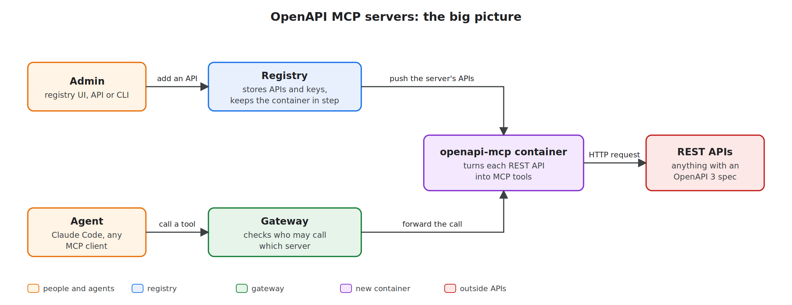
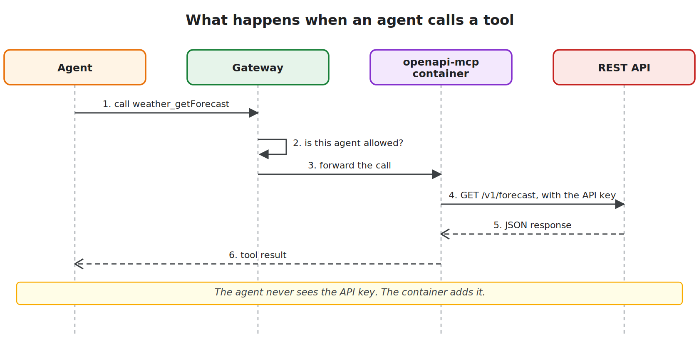
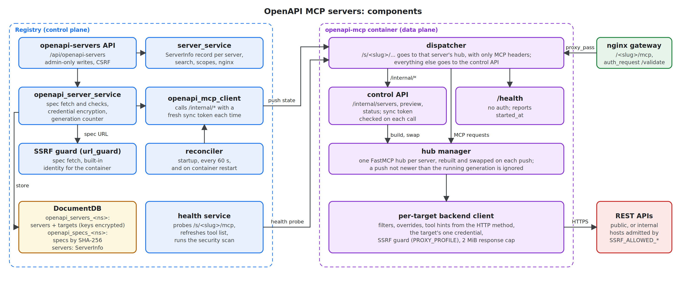
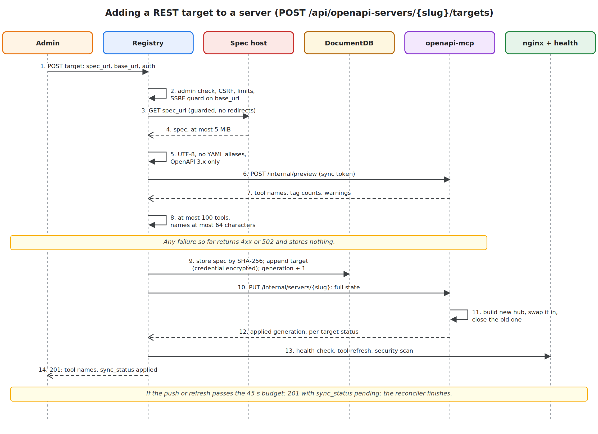
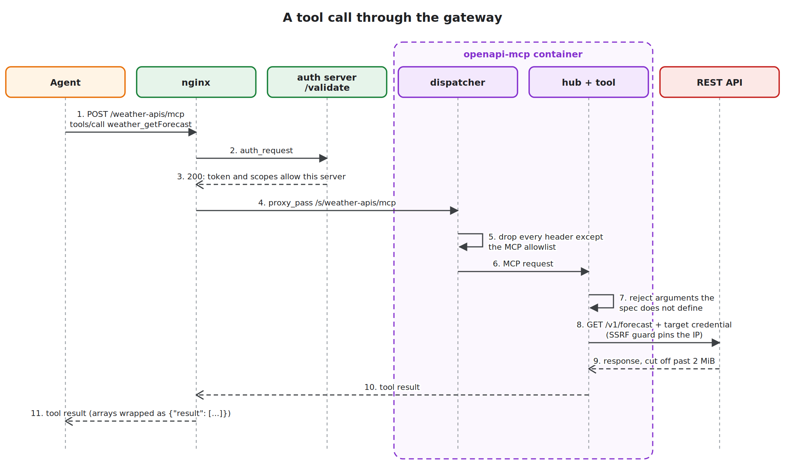
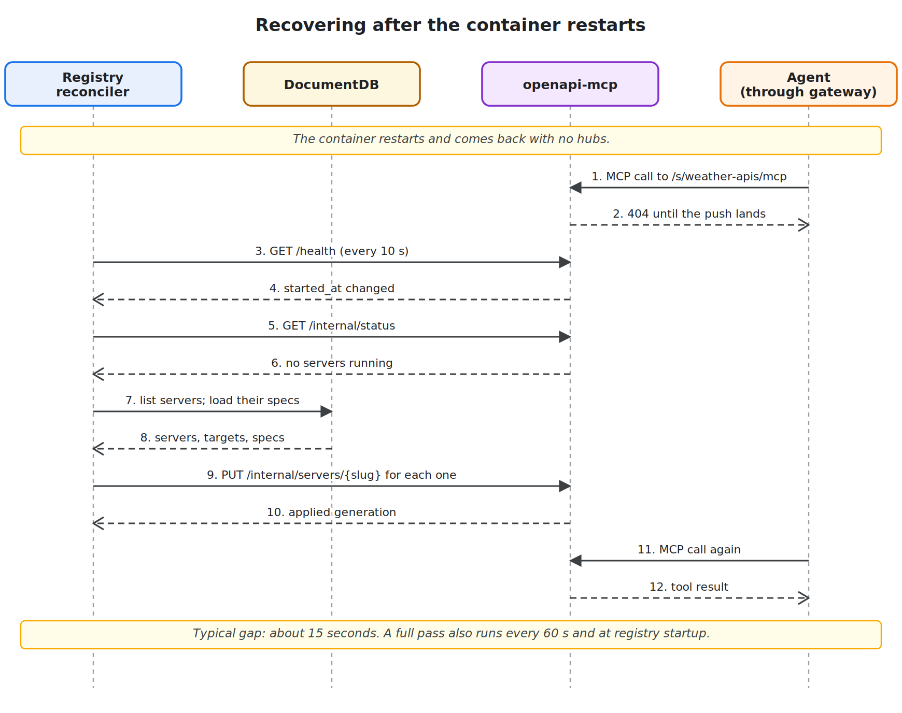
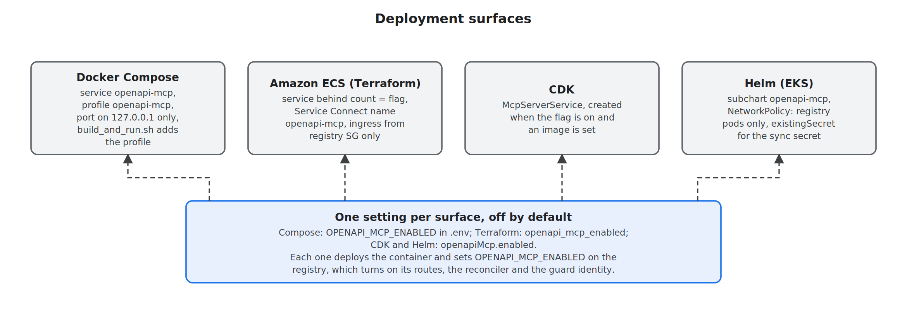

# OpenAPI MCP servers: high-level design

*Created: 2026-11-13. Issue #2022.*

*Status: the container (slice 1 of 5) is built on branch `feat/openapi-mcp-servers-2022`. The registry backend, UI and deployment wiring are still to come.*

Every diagram exists as SVG and PNG in `docs/images/`, named `openapi-mcp-servers-*`.

## 100-level: what it is and why

### The problem

Agents reach tools through MCP servers. Most teams already have REST APIs, and most of those APIs publish an OpenAPI spec that lists every operation. To let an agent use one of them through the gateway today, someone writes a small MCP server, packages it, deploys it and registers it. For most APIs that server does one thing: it turns a tool call into an HTTP request.

### What the feature does

An admin creates an OpenAPI MCP server in the registry and gives it a name. They then add REST APIs to it, each one given as a spec URL, a base URL and an API key. Every operation in the spec becomes a tool on that server. Agents connect to it the way they connect to any other MCP server, with the same login, the same access rules and the same search. Nobody writes or deploys code for each API.

### How it works

Three parts do the work:

- The **registry** stores each server, its APIs and their keys. Whenever an admin changes something, the registry sends the new state to the container.
- The new **openapi-mcp container** reads each spec, builds the tools, and makes the HTTP calls to the REST APIs.
- The **gateway** checks that the agent may use that server before it forwards the call, the same check every MCP server gets.

When an agent calls a tool, the call goes through the gateway to the container. The container calls the REST API with that API's key and returns the answer. The agent never sees the key.

### How it stays safe

Only admins can add or change APIs. The registry stores keys encrypted and never shows them again after they are entered. A new server starts private, so only admins can use it until an admin opens it to a group or to everyone. The container can call only the addresses the registry's own network guard allows, so a spec cannot point it at internal services or cloud metadata. It also strips the gateway's identity headers before it calls an outside API.

### What this version leaves out

Each API has one key that every caller shares, so there are no per-user keys yet. The registry refuses Swagger 2.0 specs, and the admin has to convert those to OpenAPI 3 first. A later version will use an LLM to review spec quality. Until then an admin can rewrite any tool's description by hand.

## 200-level: how it is built

### Components

The registry is the control plane. It owns all state and never carries REST traffic. The container is the data plane. It keeps everything in memory and can be rebuilt from the registry at any time.

| Component | Where | What it does |
|-----------|-------|--------------|
| `/api/openapi-servers` routes | registry | Create, read, update and delete servers and targets. Writes need an admin and a CSRF token. A caller who cannot see the server gets 404 |
| `openapi_server_service` | registry | Fetches and checks specs, encrypts credentials, bumps the server's generation number, and pushes state |
| `openapi_mcp_client` | registry | Makes every call to the container, each with a new sync token |
| Reconciler | registry | Compares stored state with what the container reports and pushes any server that is stale or missing |
| `server_service`, health service | registry (existing) | Each OpenAPI MCP server is an ordinary `ServerInfo` record, so search, scopes, nginx routing, health checks and the security scan work unchanged |
| SSRF guard | both | The registry uses it to fetch specs and to admit the container by exact identity. The container uses the same file for every backend call |
| Dispatcher | container | Sends `/s/<slug>/...` to that server's hub with only MCP headers, and everything else to the control API |
| Control API | container | `/internal/*`: apply a server's state, delete a server, preview a spec, report status. Each call needs a valid sync token |
| Hub manager | container | Keeps one FastMCP hub per server. A push builds a new hub, swaps it in, and closes the old one |
| Backend client | container | One per target. Holds the target's credential, applies its filters and overrides, and sends every request through the SSRF guard |

### What the registry stores

Each OpenAPI MCP server is three things in DocumentDB:

- A `ServerInfo` record with path `/<slug>` and `proxy_pass_url` set to `http://openapi-mcp:9876/s/<slug>/mcp`. It carries the tag `openapi`, and its visibility defaults to `private`.
- One document in `openapi_servers_<namespace>`, keyed by slug, that holds the server's targets. Each target records its spec URL, base URL, auth scheme, encrypted credential, filters and overrides. The document also holds a `generation` number that goes up on every change.
- One document per distinct spec in `openapi_specs_<namespace>`, keyed by the SHA-256 of the spec bytes. Two targets with the same spec share one copy, and the registry deletes a spec when no target uses it any more.

The specs live in their own collection so that a server with 50 large specs stays under DocumentDB's 16 MiB document limit.

The registry encrypts each credential with Fernet, using `registry/utils/credential_encryption.py` and a key derived from `SECRET_KEY`. That is how it already stores the backend credential of an ordinary MCP server registered through `/api/servers/register`. The OpenBao and AWS Secrets Manager backends in `registry/secrets/` stay reserved for per-user egress tokens, so this feature works on deployments that run neither.

### Interfaces

The admin API, which the UI and the CLI both use:

| Method | Path | Purpose |
|--------|------|---------|
| `POST`, `GET` | `/api/openapi-servers` | Create a server; list the servers you can see |
| `GET`, `PATCH`, `DELETE` | `/api/openapi-servers/{slug}` | Read, update or delete one server |
| `POST` | `/api/openapi-servers/{slug}/targets` | Add a REST target |
| `GET`, `PATCH`, `DELETE` | `/api/openapi-servers/{slug}/targets/{name}` | Read, update (including a new credential or a spec refresh) or delete a target |

The container serves three kinds of path, and returns 404 for anything else:

| Category | Example paths | Who calls it | Auth |
|----------|---------------|--------------|------|
| MCP endpoints, one per server | `/s/weather-apis/mcp`, `/s/petstore/mcp` | nginx, for agent traffic; the registry's health service, to probe, refresh tools and run the security scan | None of its own. nginx's `auth_request /validate` guards agent traffic, and only nginx and the registry can reach the container |
| Control API | `PUT /internal/servers/weather-apis`, `DELETE /internal/servers/weather-apis`, `POST /internal/preview`, `GET /internal/status` | The registry only | A sync token on every call |
| Health | `GET /health` | The registry's reconciler, to spot a restart; Docker, ECS or Kubernetes health checks | None. It reports only the hub count and the start time |
| Anything else | `/s/unknown/mcp`, `/foo` | | 404 |

The control API calls do the following:

| Method | Path | Purpose |
|--------|------|---------|
| `PUT` | `/internal/servers/{slug}` | Apply a server's full state |
| `DELETE` | `/internal/servers/{slug}` | Remove a server's hub |
| `POST` | `/internal/preview` | Report the tools a spec would produce, without calling the API |
| `GET` | `/internal/status` | Report each running hub's generation and per-target status |

Agents never see the container's paths. They call `/<slug>/mcp` on the gateway, for example `/weather-apis/mcp`. nginx matches that in a `location /weather-apis/` block, the same kind of block every MCP server gets, and its `proxy_pass` points at `http://openapi-mcp:9876/s/weather-apis/mcp`. The `/s/` prefix (for "server") keeps server paths apart from `/internal/` and `/health`, so no server name can shadow them.

### Adding a target

Adding a target is how third-party content, the spec, gets into the system, so the registry checks it before it stores anything:

1. The SSRF guard checks the base URL and the spec URL.
2. The registry fetches the spec without following redirects and stops reading at 5 MiB.
3. It requires strict UTF-8 and refuses YAML anchors and aliases, which can expand a small file into gigabytes. It accepts only OpenAPI 3.x.
4. The container converts the spec as a dry run and returns the tool names and the operation count per tag.
5. The registry refuses more than 100 tools per target and tool names over 64 characters. The error lists the spec's tags, so the admin can narrow the target with `include_tags` or `include_operations`.

If any step fails, the registry returns an error and stores nothing. If every step passes, the registry stores the target, pushes the server's full state, and waits for nginx to reload and for the health service to refresh the tool list. If that takes longer than 45 seconds, the call still returns 201, with `sync_status: pending`, and the reconciler finishes the work.

### A tool call

The gateway treats the server like any other: nginx asks the auth server's `/validate` whether the caller's token and scopes allow this server, then proxies to the container. Inside the container:

- The dispatcher keeps only MCP headers, such as `content-type`, `accept` and `mcp-protocol-version`. FastMCP copies every inbound header it receives onto the backend request, so without this step a third-party API would see the caller's identity headers, forwarding addresses and internal routing headers.
- The hub refuses any argument the spec does not define, so a misspelled argument returns an error. In the prototype FastMCP dropped such an argument and the API returned less data than asked for.
- The backend client adds the target's credential and sends the request through the SSRF guard, which resolves the host, checks the IP and pins the connection to it.
- The container turns a response over 2 MiB into a tool error. It wraps array responses as `{"result": [...]}`, because MCP structured output has to be an object.

Each tool carries a hint taken from its HTTP method: `GET` is read-only and `DELETE` is destructive. Clients that ask before a destructive call, such as Claude Code, then ask before a `DELETE`.

### Keeping the container in step

Only the registry starts calls between the two; the container never calls the registry. Each push carries a server's full state and its generation number. The container ignores a push that is not newer than the hub it is running, so two registry replicas pushing at once do no harm.

A container restart loses every hub. The reconciler checks the container's `/health` every 10 seconds. When the start time changes, it reads the container's status and pushes every server it finds missing or stale. It also runs a full pass at registry startup and every 60 seconds. Until the push lands, calls to those servers return 404. In a load test with 10 servers of 10 targets each, every target was serving again 23 seconds after the restart. The registry does not restart the container itself, because Compose, ECS and Kubernetes each do that their own way.

Every change also starts a background security scan of the server. A scan cut off by a container restart or a delete counts as failed, and the registry's fail-closed scan policy then disables the server; it stays disabled until an admin turns it on again. This is deliberate: a server is never re-enabled without a passing scan. A replaced hub keeps serving its in-flight calls for 30 seconds, so an ordinary change does not cut off the scan the previous change started.

### Security model

| Risk | Control |
|------|---------|
| A non-admin adds an API that spends a stored credential | Every write needs an admin (the same check virtual servers use) and a CSRF token. `can_modify_servers` is not enough |
| Credentials leak through the API | Credentials are write-only. Responses show only `credential_set: true`. Non-admins do not see spec or base URLs |
| Someone on the internal network drives the container | Every `/internal/*` call needs a sync token that lasts 60 seconds, works once, and is signed with a key derived from `OPENAPI_MCP_SYNC_SECRET`. The container never holds `SECRET_KEY` |
| A spec or base URL points at internal services or cloud metadata | The same SSRF guard runs on the spec fetch and on every backend call |
| An ordinary server registers the container as its backend | The container's hostname is reserved. Only a server whose path and target match `/<slug>` and `<container>/s/<slug>/mcp` exactly gets the built-in profile. That profile reaches only `/s/<slug>/mcp`, never `/internal/*` |
| Gateway headers reach a third-party API | The dispatcher keeps only an allowlist of MCP headers |
| A spec that expands into gigabytes, or takes a long time to convert | YAML aliases are refused, specs are capped at 5 MiB, and each conversion has 10 seconds |
| A spec carries text aimed at the model | The security scanner runs after every tool change. Admins can replace any description, and can block a single tool with the existing per-tool block |

### Limits and settings

| Setting | Default | Meaning |
|---------|---------|---------|
| `OPENAPI_MCP_ENABLED` | `false` | Turns the feature on |
| `OPENAPI_MCP_INTERNAL_URL` | `http://openapi-mcp:9876` | Where the registry and nginx reach the container. Its host becomes reserved in the guard |
| `OPENAPI_MCP_SYNC_SECRET` | none | Required when enabled. At least 32 characters, and must differ from `SECRET_KEY` |
| `OPENAPI_MCP_MAX_SERVERS` | 10 | Servers per deployment (1 to 100) |
| `OPENAPI_MCP_MAX_TARGETS_PER_SERVER` | 10 | Targets per server (1 to 50) |
| `OPENAPI_MCP_MAX_TOOLS_PER_TARGET` | 100 | Tools one target may produce after its filters (1 to 500) |
| `OPENAPI_MCP_SPEC_MAX_BYTES` | 5 MiB | Largest spec the registry fetches |
| `OPENAPI_MCP_RECONCILE_INTERVAL_SECONDS` | 60 | Time between full reconcile passes |
| `OPENAPI_MCP_BACKEND_TIMEOUT_SECONDS` | 30 | Container: timeout for each backend call |
| `OPENAPI_MCP_MAX_RESPONSE_BYTES` | 2 MiB | Container: largest response passed to the agent |

In `REGISTRY_ONLY` mode, or when `REGISTRY_MODE` turns MCP servers off, the registry turns the feature off and logs why.

### Deployment

The container ships as its own image, built from `docker/Dockerfile.openapi-mcp`. Besides its own code, the image holds nine files from the registry: the SSRF guard and its imports, the signing-secret check, and the sync-token module. It holds nothing else from the registry, including the settings class that needs `SECRET_KEY`. One replica runs, because pushes go to one address. The same load test, which included one 4.4 MB spec, peaked at 293 MiB, so ECS and CDK give the container 1024 MiB (the smallest Fargate size for 0.5 vCPU) and Helm limits it to 1 Gi.

On every surface, only the registry and nginx can reach the container: Compose keeps it on the internal network with a loopback-only port, ECS allows ingress from the registry security group, and Helm adds a NetworkPolicy. The hop between them is plain HTTP by default. A cluster that needs TLS inside can set an `https` URL.

### Observability

The registry exports these metrics on its Prometheus endpoint:

| Metric | Type | Labels |
|--------|------|--------|
| `mcpgw_openapi_mcp_operation_total` | Counter | `entity` (server, target), `operation` (create, update, delete), `result` (ok or the error code) |
| `mcpgw_openapi_mcp_operation_duration` | Histogram (ms) | `entity`, `operation` |
| `mcpgw_openapi_mcp_spec_fetch_total` | Counter | `result` (ok or the error code) |
| `mcpgw_openapi_mcp_sync_push_total` | Counter | `result`, `trigger` (mutation, reconcile) |
| `mcpgw_openapi_mcp_reconcile_drift_total` | Counter | `kind` (missing, stale, extra) |
| `mcpgw_openapi_mcp_state` | Gauge | `kind`: `servers` and `targets` (as of the last reconcile pass), `container_reachable` (1 or 0) |

Labels carry server slugs, target names and error codes, never tool names, so the number of series stays bounded. Alert when `mcpgw_openapi_mcp_state{kind="container_reachable"}` stays at 0 for five minutes, and on any rise in `mcpgw_openapi_mcp_reconcile_drift_total{kind="missing"}`, which means the container restarted.

### Choices we rejected

| Option | Why not |
|--------|---------|
| Run the hub inside the registry process | Puts REST traffic through the control plane, and a hung API or a huge spec would share a process with login and search |
| One container per server | The registry would need permission to start containers on Compose, ECS and Kubernetes, each in its own way |
| The container pulls its state from the registry | Needs calls in both directions and a registry endpoint that hands out decrypted credentials |
| Edit a running hub in place | FastMCP has no unmount call. Rebuilding a hub takes a second at most and uses only public calls |
| Store credentials in OpenBao or AWS Secrets Manager | That store holds per-user egress tokens only, needs `EGRESS_AUTH_ENABLED`, and has no interface for a shared credential. Fernet in DocumentDB follows how ordinary servers' credentials are stored today |
| Call these "virtual MCP servers" | "Virtual servers" already names the nginx tool aggregators under `/virtual/<slug>` |

### Build plan

| Slice | Contents | Status |
|-------|----------|--------|
| 1 | Container, sync token, image | Done, commit `a37f0ca5d` |
| 2 | Registry backend: settings, models, repositories, guard identity, service, reconciler, routes, metrics | Next |
| 3 | Compose, CLI and client, mock REST API, integration test, docs | Planned |
| 4 | Registry UI | Planned |
| 5 | Terraform, CDK, Helm, image publishing | Planned |
