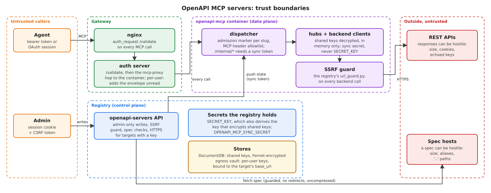
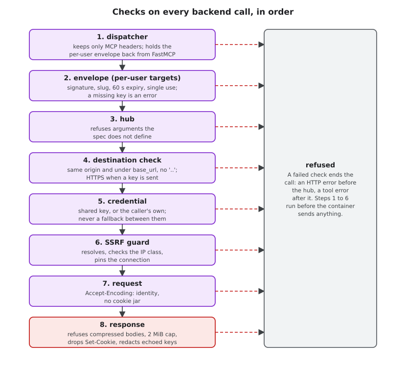
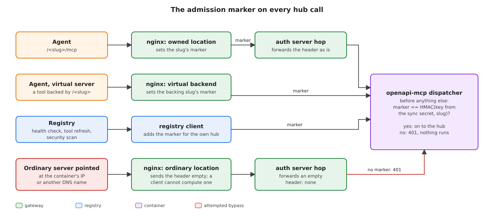

# OpenAPI MCP servers: security design

*Created: 2026-11-20. Issue #2022, PR #2039.*

This document covers what OpenAPI MCP servers protect, where the trust boundaries sit, and which check enforces each rule. The feature itself is described in [openapi-mcp-servers-design.md](openapi-mcp-servers-design.md), and the operator guide is [../openapi-mcp-servers.md](../openapi-mcp-servers.md). The repository-wide rules these controls follow are in [../SECURITY_GUIDELINES.md](../SECURITY_GUIDELINES.md).

## What needs protecting

An OpenAPI MCP server lets an agent call a REST API with a key the agent never sees. The design protects four things:

- **Shared keys.** An admin enters one key for a target, and every caller who may use the server spends it.
- **Per-user keys.** Each user stores their own key for a target. One user's key must never be sent on another user's call, or to any host other than the target's.
- **The gateway's access decision.** A call reaches a hub only after nginx and the auth server have checked the caller's token and scopes for that server. No other route may reach a hub and spend its key.
- **The container's network position.** The container can reach APIs that an operator admitted through `SSRF_ALLOWED_HOSTS` or `SSRF_ALLOWED_CIDRS`. A spec, a base URL or a backend response must not turn that reach into access to anything else.

## Trust boundaries

The registry is the only component that stores anything. It holds `SECRET_KEY`, which also derives the key that encrypts shared keys in DocumentDB, and `OPENAPI_MCP_SYNC_SECRET`, which signs every call the registry makes to the container. Per-user keys live in the egress vault, keyed on the user's immutable IdP id and bound to the target's canonical base URL.

The container holds the sync secret and, in memory only, the decrypted shared keys of the servers it runs. It never holds `SECRET_KEY` and never calls the registry. It treats every spec and every backend response as hostile.

Every MCP call reaches the container through the auth server: nginx asks its `/validate` whether the caller may use the server, then proxies the call to its mcp-proxy hop, which forwards it to the container. For a server with per-user targets the hop also asks the registry to vend a credential and forwards the result without reading it, so the auth server never holds the sync secret either.

## Who can change a server

Only an admin can create, change or delete an OpenAPI MCP server or its targets, and every write also needs a CSRF token. The `can_modify_servers` permission is not enough, because a target spends a stored key on behalf of everyone who may call the server.

The OpenAPI MCP service owns the server's `ServerInfo` record, marked by `metadata.openapi_server`. `check_openapi_ownership` runs in the `server_service` write path, so every generic route that would edit, replace or repoint the record gets `409`. No other registration may point at the container: only a record whose path and target match `/<slug>` and `<container>/s/<slug>/mcp` exactly gets the built-in SSRF profile that admits the container's host.

When the service updates the record, it writes only the fields it owns (`updated_fields`). It used to write back the whole record it had read, which could undo an admin's disable or tool block that landed between the read and the write.

## Checks before a target is stored

Adding or changing a target stores nothing until every check below passes. The sequence diagram is in the design doc, under [Adding a target](openapi-mcp-servers-design.md#adding-a-target).

| Check | What it stops |
|-------|---------------|
| SSRF guard on the base URL and the spec URL, with nginx metacharacters refused | A target or spec fetch aimed at loopback, private ranges or cloud metadata |
| `https://` base URL for any target with a key, unless the operator allowlisted the host by name or the IP literal by CIDR | A key sent in clear over the internet |
| Spec fetched with no redirects and `Accept-Encoding: identity`; a compressed response is refused before it is read | A redirect into a private address, and a small compressed body that decodes into gigabytes before the size cap sees it |
| At most 5 MiB, valid UTF-8, no YAML aliases, OpenAPI 3.x, local `$ref` values only | Alias bombs, and a later FastMCP version that might follow a remote or file `$ref` |
| No `.` or `..` path segment or backslash in any spec path, raw or percent-encoded | A spec path such as `/../../other/collect` that sends the key outside the approved base path |
| A dry-run conversion in the container, at most 100 tools, names at most 64 characters, 10 seconds per conversion | Specs that are too large to review or too slow to convert |

## Checks on every backend call

The dispatcher forwards only an allowlist of MCP headers to the hub. FastMCP copies every inbound header onto the backend request, so without the allowlist a third-party API would receive the caller's identity, forwarding and routing headers. The dispatcher also takes the per-user envelope out of the headers before FastMCP sees them.

For a per-user target, the container verifies the envelope: a JWT signed with a key derived from the sync secret, bound to the server's slug, valid for 60 seconds and accepted once. It carries every key the caller stored for that server. A target with no key in the envelope returns a tool error; it never falls back to a shared key.

The backend transport then checks the final URL before anything leaves the container. The URL must have the target's scheme, host and port, and its path must stay under the base path, with no dot segments or backslashes left after FastMCP builds it. A call that carries a key must use HTTPS unless the operator trusts the host. Only after these checks does the transport attach a per-user key and hand the request to the SSRF guard, which resolves the host, checks the address class and pins the connection to the checked IP.

Each target's HTTP client stores no cookies, and the transport drops every `Set-Cookie` header. A backend that set a session cookie on one user's call could otherwise have that cookie replayed on the next user's call, even though the key changed. The transport also asks for an uncompressed response and refuses a compressed one before reading it, then cuts off a body past 2 MiB.

Before the response reaches the agent, the transport replaces every form of the key it attached with `[REDACTED]`: the raw value, its URL-encoded forms, the base64 of a basic-auth pair, and its JSON-escaped forms. A backend that echoes the key in a JSON body would otherwise get it past a raw-byte match, because a quote or backslash in the key comes back escaped. The transport skips keys shorter than 6 characters, because replacing them would corrupt ordinary text.

## What a caller sees

Credentials are write-only. Responses show `credential_set: true` and nothing else about the key. Callers who are not admins see neither spec URLs nor base URLs.

Target responses list only the tool names the caller's scopes grant, through `filter_tools_for_user`, the same filter every other server's tool list uses. The override maps and include filters name operations too, so only admins see them. A target the container could not load shows non-admins a generic error, because the real one can quote the spec.

## Logging

The container logs a refused backend call by its reason only. The URL can carry a key in its query string, and the guard's own exception text includes the URL, so neither is logged. No log line carries a key, an envelope or a sync token.

## Network isolation

The container does not authenticate callers itself; the gateway does. The container relies on two things: only the registry and the auth server can reach its port, and every hub call carries the admission marker described below.

| Deployment | Isolation |
|------------|-----------|
| Docker Compose | Its own `openapi-mcp` network, shared with the registry and the auth server, with no published port |
| Amazon ECS | A security group that admits only the registry and auth-server security groups |
| Helm | A NetworkPolicy that admits only the registry and auth-server pods. It has no effect on a cluster that does not enforce NetworkPolicy, such as EKS with the VPC CNI's policy agent off |

Network isolation cannot tell an authorized gateway call from a gateway call made on behalf of a different registration. The admission marker covers that case.

## The admission marker

### The gap it closes

The registry reserves the container's hostname, so no ordinary registration can name `openapi-mcp`. The same container is also reachable by IP address (a ClusterIP, a task IP) or by another DNS name. On a deployment where the operator admits that range through `SSRF_ALLOWED_CIDRS` or allows private targets, someone who may edit an ordinary registration could point it at `http://<container-ip>:9876/s/<victim-slug>/mcp`. The gateway would check the caller against the ordinary registration and forward the call from an allowed source, and the victim hub would spend its shared key. The default configuration, with an empty allowlist, does not admit that address.

### How it works

The container requires an `X-OpenAPI-MCP-Admission` header on every `/s/<slug>/...` call. Its value is an HMAC-SHA256 of the slug, keyed with a key derived from the sync secret (`admission_marker` in `registry/auth/openapi_mcp_sync.py`). The dispatcher computes the value for the slug in the path and refuses a missing or wrong marker with `401` before it looks up the hub, so an unadmitted caller cannot even learn which slugs exist. The header is not in the MCP allowlist, so no backend ever receives it.

Only the routes that serve a slug can produce its marker:

- **nginx.** The registry writes the marker into the location of each OpenAPI MCP server it owns. The auth server's mcp-proxy hop forwards it unchanged on both the shared-key and the per-user paths. Every other MCP location sends the header empty, which drops a client-supplied copy.
- **Virtual servers.** The internal location for a virtual server's backend sets the marker of the backing server when that backend is an OpenAPI MCP server, and sends it empty otherwise.
- **The registry's own calls.** Health checks, tool refreshes and the security scan add the marker through `admission_headers` in `registry/services/openapi_ownership.py`. It returns a marker only for a record at `/<slug>` whose target is exactly `<container>/s/<slug>/mcp`, and only when the call goes to that URL. The ownership rule keeps every other record off the container's hostname, so a record that reaches the container by IP gets no marker and its health check fails. The scanner receives the marker in its environment and turns it into its `--header` flag inside the child process, the same way it receives its bearer token, so the value never appears on a command line.

### Why a marker, and not a per-request token

The review that found the gap suggested a short-lived admission token bound to each request. A token like that needs a mint on every call, a replay store and a clock check in the container. The marker needs none of these, because the gateway has already authorized the caller: the container only has to learn which route the call came through, and only the routes that serve a slug can produce its marker.

The marker does not expire. Anyone who can read the generated nginx config or the registry's environment can replay it, but those readers already hold the sync secret. Rotating the sync secret changes every marker at the next nginx reload and push.

### Upgrading

The registry and the openapi-mcp container must come from the same release. A container that requires the marker refuses every hub call from a registry that does not send one. The auth server needs no change, because it already forwards the header.

## Known limits

- **Visibility and tool calls.** `private` and `group-restricted` decide who can see a server in the registry API. MCP calls follow scope grants, as they do for every other server type, so a caller with an existing grant can call a private server. This applies to the whole platform and has its own follow-up below.
- **Plaintext internal hops.** The registry pushes decrypted shared keys to the container, and the envelope holds per-user keys. The registry signs both but encrypts neither, and they cross the internal network over plain HTTP unless an operator sets `OPENAPI_MCP_INTERNAL_URL` to an `https` URL. Anyone who can read traffic on that network can read the keys.
- **Network policy enforcement.** On Helm, isolation depends on a cluster that enforces NetworkPolicy.
- **Compose backends.** A REST API run as another Compose service has to join the `openapi-mcp` network, which also lets it call the container's port directly.

## Follow-up work

| Item | Notes |
|------|-------|
| Visibility at the execution boundary | Platform-wide: apply `visibility` and `allowed_groups` in `/validate` for every server type, including virtual backends |
| TLS for internal hops | Default `OPENAPI_MCP_INTERNAL_URL` to HTTPS on each deployment surface, with a CA bundle for the private certificate |
| Bounded decompression in health probes | `registry/health/service.py` reads a `server/discover` response with `aiter_bytes()`, which decodes a compressed body before its size check. The same fix applies |

## Review history

A security review on 2026-11-18, at revision `ee8a3744b`, raised eight findings and four callouts. Status after this change:

| Finding | Status |
|---------|--------|
| 1. Pooled clients replay one user's backend cookie for another | Fixed: no-store cookie jar, `Set-Cookie` dropped |
| 2. A container alias or IP reaches a hub | Fixed: the admission marker |
| 3. Visibility does not restrict tool calls | Not changed in this PR; see Known limits |
| 4. A spec path escapes the approved base path | Fixed at admission and before each call |
| 5. Full-record writes undo a disable or tool block | Fixed: field-scoped writes |
| 6. Decompression allocates before the size cap | Fixed: identity encoding asked for, compressed bodies refused, in the container and the spec fetch |
| 7. JSON-escaped echoes escape redaction | Fixed: JSON-escaped forms redacted |
| 8. Target reads show tools the caller has no grant for | Fixed: tool names filtered, overrides admin-only |
| Callout: a refused URL is logged | Fixed: reason only |
| Callout: keys over HTTP | Fixed: HTTPS required unless the host is operator-trusted |
| Callout: hub calls rely on network isolation | Addressed: the admission marker |
| Callout: envelopes are signed, not encrypted | Known limit; TLS follow-up |
