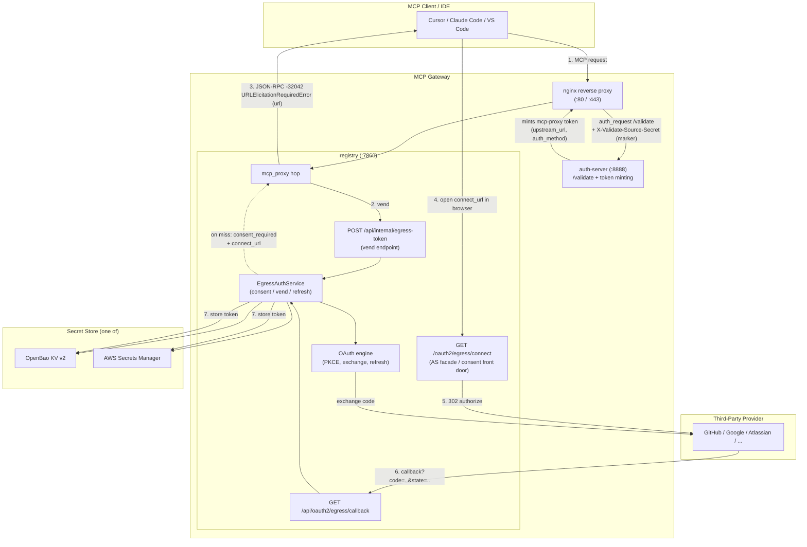
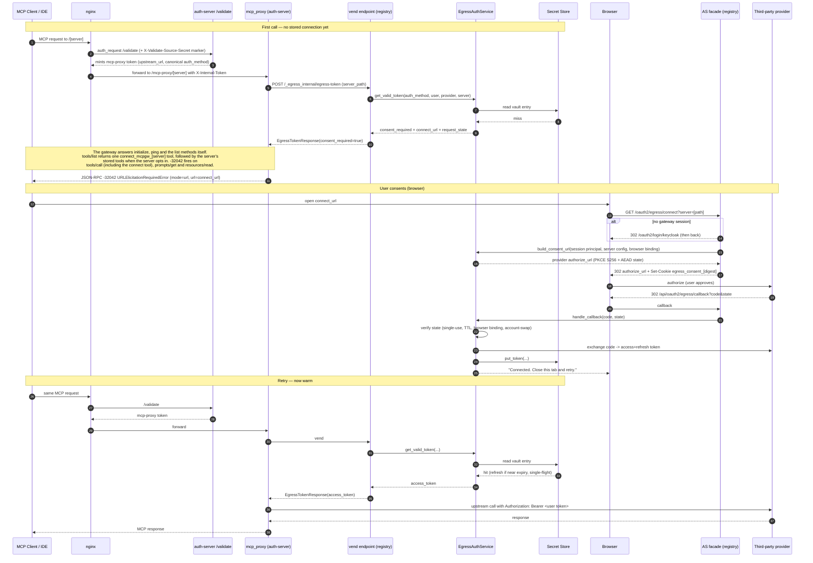

# Per-User Egress Credential Vault (Third-Party OBO)

*Status: Feature documentation. Off by default (`EGRESS_AUTH_ENABLED=false`).*

The per-user egress credential vault lets an MCP agent act **on behalf of** the
end user against a third-party API (GitHub, Google, Atlassian, Microsoft, Slack,
or any custom OIDC provider). Instead of every MCP server holding a single shared
service credential, each user completes a one-time OAuth consent and the gateway
stores **their own** access/refresh tokens in a per-user vault. On every
subsequent call the gateway transparently vends (and refreshes) that user's token
and injects it into the upstream request.

This is the *egress* (outbound) counterpart to the gateway's *ingress* (inbound)
OAuth — ingress authenticates the client **to** the gateway; egress authorizes
the gateway to call a third party **as** the user.

---

## Table of Contents

- [Concepts and terminology](#concepts-and-terminology)
- [Architecture](#architecture)
- [Runtime sequence](#runtime-sequence)
- [Secret store backends](#secret-store-backends)
- [Vault key scheme](#vault-key-scheme)
- [HTTP API surface](#http-api-surface)
- [Environment variables](#environment-variables)
- [Setup: infrastructure (OpenBao / Secrets Manager)](#setup-infrastructure)
- [Setup: configuring an MCP server for egress](#setup-mcp-server)
- [Setup: the IDE / MCP client experience](#setup-ide)
- [Security model](#security-model)
- [Operations and troubleshooting](#operations-and-troubleshooting)

---

## Concepts and terminology

| Term | Meaning |
|------|---------|
| **Egress auth** | Outbound authorization: the gateway calling a third-party API as the user. |
| **OBO (on-behalf-of)** | The agent acts with the user's own delegated authority, not a shared bot identity. |
| **Vault / secret store** | Where per-user third-party tokens live. Two backends: **OpenBao** (EKS/Helm) or **AWS Secrets Manager** (ECS). |
| **Consent** | The one-time OAuth authorize flow the user completes per `(provider, server)`. |
| **Vend** | The internal call that hands a valid third-party access token to the proxy hop at request time. |
| **AS facade** | The gateway's own session-verified "connect" front door (`/oauth2/egress/connect`) that brokers consent — the MCP client itself performs no OAuth. |
| **Marker secret** | A shared secret nginx force-injects on the `/validate` subrequest so a direct `:8888` caller cannot mint an egress-capable token. |
| **Elicitation** | The MCP URL-mode elicitation mechanism (`2025-11-25` `URLElicitationRequiredError`, JSON-RPC error `-32042`) the gateway uses to ask the client to open the consent URL in a browser. |

---

## Architecture

The feature spans three services. The **registry owns the full feature** (secret
store, OAuth engine, consent facade, vend endpoint). The **auth-server** only mints
the egress-capable proxy token and calls the registry's internal vend endpoint.
**nginx** ties them together and enforces the marker secret.



### Module responsibilities (registry)

| Module | Responsibility |
|--------|----------------|
| `registry/egress_auth/service.py` | `EgressAuthService` — orchestrates consent URL build, callback handling, token vend, single-flight refresh, list, disconnect. |
| `registry/egress_auth/oauth_engine.py` | PKCE generation, `build_authorize_url`, `exchange_code`, `refresh_token`; per-provider token-response parsers and auth styles. |
| `registry/egress_auth/providers.py` | `PROVIDER_REGISTRY` (GitHub, Google, Atlassian, Microsoft, Slack) + `resolve_provider` for custom OIDC. |
| `registry/egress_auth/state_codec.py` | AEAD (AES-256-GCM) encrypt/decrypt of the short-lived OAuth `state` blob — hides the PKCE verifier from the URL/logs. |
| `registry/egress_auth/browser_binding.py` | The per-consent cookie that binds a consent to the browser that started it: secret, digest, cookie name, set, compare, clear. |
| `registry/egress_auth/fallback_key.py` | `username_fallback_key`, the namespaced vault `user_id` for a login with no account id; only the auth-server's login callback calls it, and it stores the result on the subject-less session. |
| `registry/egress_auth/session_vault_user.py` | `session_vault_user_id`, the one reader of a session's vault key, used by the auth-server's cookie path, the token mint and the registry's `enhanced_auth`. |
| `registry/egress_auth/as_facade.py` | Helpers to test whether a server is egress-configured. |
| `registry/egress_auth/factory.py` | Singleton service wiring; binds the Mongo replay-guard + cross-replica refresh lease (falls back to in-process for single-replica dev). |
| `registry/secrets/interfaces.py` | `SecretStoreBase` ABC: `put_token` / `get_token` / `delete_token` / `list_for_user`. |
| `registry/secrets/keys.py` | Deterministic, collision-free vault-key canonicalization (NFC + base64url). |
| `registry/secrets/factory.py` | Selects and builds the configured backend. |
| `registry/secrets/openbao/store.py` | OpenBao KV v2 backend (one entry per connection; re-auth on token expiry). |
| `registry/secrets/secrets_manager/store.py` | AWS Secrets Manager backend (one JSON-map secret per principal; read-merge-write-verify). |
| `registry/api/egress_auth_routes.py` | Vend endpoint, server-config CRUD, consent initiate, OAuth callback, connections list/delete. |
| `registry/api/egress_oauth_facade_routes.py` | `GET /oauth2/egress/connect` — the session-verified consent front door. |

---

## Runtime sequence

The interesting case is a **cold** call — the user has not yet consented for this
`(provider, server)`. The gateway intercepts, asks the client to open a browser
via MCP elicitation, brokers consent, then the client retries and succeeds.



Key points:

- The **MCP client performs no OAuth itself** — no discovery, no DCR, no token
  exchange. It only opens the gateway-issued `connect_url`. The consent is
  brokered by the gateway's AS facade, which requires a live gateway session.
- The **`connect_url` points at the gateway**, never directly at the provider.
  This is an anti-phishing boundary: the session principal at the facade — not
  any client-supplied value — drives which user the token is stored under.
- The **canonical `auth_method`** ensures consent-write and vend-read address the
  same vault namespace. IdP-specific methods (keycloak, entra, cognito, okta,
  auth0, pingfederate) all canonicalize to `oauth2` so a user does not get asked
  to re-consent on every call.

### Why not point the client straight at the provider?

The vend response carries one URL, `connect_url` (the gateway's own
`/oauth2/egress/connect` front door), and the mcp_proxy hop puts it in the `-32042`
URLElicitationRequiredError `url` field. Earlier releases also returned the
provider authorize URL as `authorize_url`; the vend no longer builds one, because a
consent has to start in the browser that finishes it and the vend has no browser.
A natural question is: since the
callback returns to the gateway anyway,
why not just hand the client the provider's authorize URL directly? Three
reasons make the gateway hop mandatory rather than incidental:

1. **PKCE verifier secrecy.** The provider authorize URL carries a PKCE
   `code_challenge`; its matching `code_verifier` must be held by whoever later
   calls the provider's token endpoint. In this design the **gateway** performs
   the code exchange, so the gateway must own the verifier. The
   [`state_codec`](#architecture) AEAD-encrypts the state precisely so the
   verifier never appears in any URL the client sees. The gateway generates the
   provider URL + verifier server-side, only *after* it has verified the
   session. If the client opened the provider directly, the verifier would
   either have to leak to the client or the client would have to run the token
   exchange itself — defeating the "client performs no OAuth" property.

2. **Session-bound anti-phishing.** `/oauth2/egress/connect` verifies the
   opener's **gateway session** before starting consent and stores the resulting
   token under that *session principal* — never under an identity the client
   asserts. This checkpoint binds "the human who consented" to "the user the
   token is vaulted for." Without it, a leaked or relayed elicitation URL could
   cause user A's third-party token to be stored against user B's vault key.
   The same response sets the consent cookie (see "Browser binding" under
   [Security model](#security-model)), which only a gateway route can do.

3. **DCR-free provider support.** Driving the provider's authorize URL directly
   would require the client to be a registered OAuth client at that provider
   (a static `client_id` or RFC 7591 Dynamic Client Registration). Brokering
   through the gateway keeps the single OAuth app credential on the server's
   egress config, so the client needs nothing — and it works with providers
   like Microsoft Entra that do not support DCR.

The callback returning to the gateway is the *back half* of this same flow, not
an independent step: the gateway decrypts the `state` to recover the verifier it
generated, exchanges the code at the provider, and writes the token under the
state-bound principal. Because the **same party (the gateway) both starts
consent and receives the callback**, the flow is internally consistent. Had the
client initiated directly against the provider, the gateway would receive a
callback for a flow it never started — with no verifier to complete the exchange
and no principal binding to know whose vault to write.

---

## Secret store backends

The vault stores the SECRET payload (`StoredToken`: access token, refresh token,
expiry, scopes, status, client_id). Two backends implement the same
`SecretStoreBase` contract:

| Backend | Surface | Layout | Auth |
|---------|---------|--------|------|
| **OpenBao** (`secret_store_backend=openbao`) | EKS / Helm | One KV v2 entry per connection at `{prefix}/{auth}/{user}/{provider}/{server}` | `token`, `kubernetes`, or `approle`; re-authenticates on token expiry. |
| **AWS Secrets Manager** (`secret_store_backend=secrets-manager`) | ECS / Terraform | One secret per principal holding a JSON map `{map_key: StoredToken}` | IAM task role; optional CMK for envelope encryption. Read-merge-write-verify for concurrent writers. |

> There is no local file backend. `secret_store_backend` accepts only
> `openbao` or `secrets-manager`. The default is `openbao`.

---

## Vault key scheme

The vault key is the tuple `(auth_method, user_id, provider, server_path)`. Raw
values are not safe as path/map segments (Auth0 `sub` contains `|`, Keycloak
usernames contain spaces/accents, `server_path` contains `/`). Every backend
builds keys through `registry/secrets/keys.py`, which applies **one** canonical
encoding: NFC-normalize, then **base64url (unpadded)**, so each segment contains
only `[A-Za-z0-9_-]` — never `/`, `|`, `%`, or `=`.

### The key carries the consent `purpose`

Each consent purpose has its **own address space**. A `purpose=egress` consent (a
user connecting their own account for runtime calls) and a `purpose=discovery`
consent (an admin designating the identity the registry borrows for its own
headless health checks and tool discovery — see
[OAuth 2.1 backend discovery](obo-token-exchange.md)) never resolve to the same
entry, even for the same principal, provider and server.

`keys.namespaced_prefix` builds the prefix. For `egress` it returns the configured
prefix **unchanged** — that is deliberate, because every entry written before
purposes existed is an egress entry, so existing addresses are byte-identical and
no migration or re-consent is needed. `discovery` nests one segment deeper, inside
the same configured prefix, so vault policies and IAM scoping that grant the prefix
keep working untouched:

```
egress/b2F1dGgy/YWxpY2U/Z2l0aHVi/L2dpdGh1Yi1tY3A                 <- egress:    4 segments
egress/ZGlzY292ZXJ5/b2F1dGgy/YWxpY2U/Z2l0aHVi/L2dpdGh1Yi1tY3A    <- discovery: 5 segments
```

Depth alone makes a collision impossible, so the two purposes cannot evict,
re-scope, or read each other. That is why there is no cross-purpose consent check
to describe: the same principal can hold their own runtime connection to a server
**and** be the designated discovery identity for it at the same time, and both
stand. `get_valid_token` takes `purpose` as a required argument with no default,
because a default is precisely how a caller would cross the boundary by omission.

One consequence to be aware of: `list_for_user` reads the egress space only, so a
borrowed discovery identity does **not** appear in the consenting user's Connected
Accounts. Remove it through the server's discovery config
(`DELETE /api/servers/{path}/oauth-discovery`), which also revokes the stored token.

### The canonical `user_id` (OIDC `sub`)

`user_id` is the caller's **immutable account id at the IdP**, not their display
username or any other name the account can change or a later account can take.
For most providers that id is the OIDC `sub`. Keying on the display name instead
would break on Entra, whose **access** tokens omit `preferred_username`: a DCR
client's bearer token would key on `sub` while the browser-consent leg keyed on
the email, so the token would be written and read under different ids and every
vend would miss. A reusable name also hands one account's vaulted tokens to the
next account that holds it.

| Provider | `user_id` | Notes |
|----------|-----------|-------|
| Keycloak, Auth0 | token `sub` | The browser login stores the id_token `sub`; a bearer token keys on its own `sub`. |
| Entra | token `sub` | As for Keycloak, but Entra issues a different `sub` per application; see [Entra: one key per application](#entra-one-key-per-application). |
| Cognito | token `sub` (a UUID) | The login reads it from the verified access token, or from the `sub` attribute boto3 `GetUser` returns when JWT verification is unavailable. A `GetUser` response without `sub` fails validation, and the login then takes `sub` from the userInfo endpoint. It is never the Cognito username: Cognito frees a username when its user is deleted, and a new user created under that name would otherwise read the old user's connections. |
| Okta | access token `uid` when it is a non-empty string; on a client-credentials token, `sub` | An Okta user access token carries the user's login (editable, often an email) in `sub` and the immutable user id in `uid`. The id_token carries that user id as `sub`, so both paths agree. A client-credentials token has no `uid` and is issued to itself, so its `sub` equals its `cid` and it keys on that client id. A user token whose `uid` is missing, empty or not a string has no key, and the vend refuses it rather than key on the login in `sub`. `uid` is read only from tokens the Okta provider validated. |
| PingFederate | token `sub` | The deployment decides what `sub` holds. Map it to the same immutable attribute (for example the directory object GUID) in both the OpenID Connect policy, which builds the id_token, and the access token manager, which builds the bearer token. Different attributes split the browser and bearer paths; a mutable one such as email gives a renamed user's connections to the next holder of the address. |
| GitHub, Google | userinfo `id` (`subject_claim: "id"`) | Their userinfo endpoints have no `sub`. |

The auth-server derives the canonical id (`_canonical_egress_user`: the Okta account id on an Okta bearer, else `sub`; a bearer with neither gets no key) and carries it to the registry as an `egress_user` claim on the internal tokens. A browser session gets its key once, at login: the callback stores the account id, or for a login with none the username fallback key, on the session record as `egress_user`. The browser consent-write path reaches the registry through the cookie session rather than an internal token, so every reader of a session's key reads that stored field through one function, `session_vault_user_id` (`registry/egress_auth/session_vault_user.py`): the auth-server's cookie path, the token mint and the registry's `enhanced_auth`. The two services read the session record through separate session stores, and since no other session field feeds the key, a field that one store returns and the other does not cannot split it. All four identity points (vend, consent initiate, the OAuth callback's account-swap guard, and list/disconnect) key on this one value.

A caller whose login yields no account id falls back to a namespaced username key; see [When the key falls back to the username](#when-the-key-falls-back-to-the-username) for who reaches that step and what it costs.
The registry never applies a fallback of its own to an internal token: `vault_principal` reads `egress_user` alone, so a caller the auth-server gives an empty key is refused by every registry vault route as well as by the vend.
Two places deliberately fail closed rather than cross identifier namespaces: a
gateway-minted `self_signed` token with no `egress_user` claim resolves to the
empty string (its `sub` is the login username by construction, not the OIDC sub),
and the vend refuses a per-user caller whose `egress_user` claim is empty,
logging a warning instead of keying on that token's `sub`. Both make the
otherwise-silent "consent succeeds, then 0 tools" failure visible; a token
minted before the claim existed is refused for at most one token lifetime and
the next mint carries the claim.

The session subject comes from the IdP at login: the id_token `sub` for
Keycloak, Entra, Okta, Auth0 and PingFederate, the access token `sub` for
Cognito, or, on the userinfo fallback, the field named by the provider's
`subject_claim` (default `sub`; `id` for GitHub and Google, whose userinfo
endpoints have no `sub`). A Keycloak, Cognito, Entra, Okta, Auth0 or
PingFederate login that yields no subject is refused with HTTP 401 and creates
no session, because the vault would otherwise key that user on the username.
The auth-server refuses a login through any other provider the same way when
its token response carries an id_token, since an id_token marks the provider
as OpenID Connect. A GitHub, Google or custom provider login with no id_token
and no subject still succeeds and logs a warning, and its bearer tokens are
refused at the per-user vend. Auth0, GitHub, and Google sessions created
before the subject was captured keyed their grants on the username; those
users sign in again and reconnect each egress server once.
`auth_method` still canonicalizes across IdP methods (see below), so the full
key is stable regardless of how the same human authenticated.

**Upgrading to immutable-id keying.** Two groups of callers find their existing
connections gone and reconnect each egress server once from Connected Accounts:

- Cognito users who sign in through the access-token path (the default when
  `COGNITO_USER_POOL_ID` is set). Earlier releases stored their session subject
  as the Cognito username, so their connections sit under the username. A
  bearer validated through the boto3 `GetUser` fallback moves from the username
  to the `sub` as well.
- Clients that present a raw Okta access token. Their connections sit under the
  user's Okta login, and the vault now keys them on `uid`.

The old entries stay in the secret store. After the upgrade no Okta user token
or session keys on the login (Okta sessions always stored the user id, and the
tokens minted from them carry it), so login-keyed entries are unreadable. Cognito username-keyed
entries stay readable for a bounded time: a token the gateway minted from a
Cognito session before the upgrade carries the username as `egress_user` until
its `exp`, at most `MCP_TOKEN_MAX_TTL_HOURS` (24 hours by default) after the
mint. A session created before the upgrade has no vault key at all (see
"Sessions created before this release" below). To end it sooner, delete the
username-keyed entries: decode the `user_id` segment of each entry path
(base64url, see the layout below) and remove the entries whose value is not a
Cognito `sub` UUID. Deleting sessions does not revoke tokens already minted,
which are stateless JWTs and stay valid until they expire.

**Discovery designations made before the upgrade.** A discovery identity designated by a Cognito user names that user's
Cognito username, and one designated with a raw Okta access token names the Okta login. The designee now has the Cognito
`sub` (or the Okta `uid`) as their principal, so `/oauth2/egress/connect?purpose=discovery` refuses them. Saving the
server's discovery config again does not help: `PUT /api/servers/{path}/oauth-discovery` keeps an existing designation
that names someone other than the caller, so that one admin's edit cannot take another's designation. To re-designate,
the server owner or an admin sends `DELETE /api/servers/{path}/oauth-discovery`, then the designee sends the `PUT` and
connects again. The registry does not match the old name to the new id on its own, because a reused username is the case
the new key closes. A designation made by a user whose login maps no subject (a GitHub, Google or custom login) names
the bare username, while that user's principal is now `name:<provider>:<username>`; the same `DELETE` then `PUT`
re-designates them.

**OIDC logins that now fail.** Earlier releases let a login that mapped no subject through with a warning. This release
refuses it with HTTP 401 ("Login response did not identify the account") for Keycloak, Cognito, Entra, Okta, Auth0 and
PingFederate, and for any provider whose token response carries an id_token, including Google and any provider you
added. A deployment that hits this locks out every user of that provider. It happens, for example, when a Keycloak or
Okta client does not request the `openid` scope, so the login falls back to userInfo, or when a custom mapping names a
`subject_claim` the response lacks. Before you upgrade, search the auth-server logs for `yielded no subject`. Each line
names a provider. Fix that provider's `subject_claim`, or its scopes so the IdP returns an id_token, before the upgrade.

**PATs left under another `auth_method`.** Earlier releases stored a PAT an admin submitted on another user's behalf (
`PUT /api/servers/{path}/egress-pat` with `sub` and `auth_method`) under the `auth_method` the admin sent, such as
`keycloak` or `jwt`. The vend reads only the `oauth2` bucket, so those PATs never reached an upstream, and since this
release no route reads them at all. To find them, list the entries under the configured prefix and base64url-decode the
first segment after it (see the layout below). Any value other than `oauth2` (`b2F1dGgy`) or the discovery segment (
`ZGlzY292ZXJ5`) marks such an entry. Submit the PAT again, which stores it under `oauth2`, then delete the old entry.

**Bearer callers the vend already refused.** Earlier releases of the registry keyed a caller with an empty `egress_user` on its login name: an Okta user access token without a usable `uid`, and a gateway-minted token without an `egress_user` claim. The vend refused those callers, but initiate, the connection list, disconnect and PAT submit used the login. Every registry vault route now refuses them too (403 from initiate and PAT submit, an empty list). Entries they wrote stay in the secret store under the login and nothing reads them.

**Bearer tokens without `sub`.** Earlier releases keyed a provider access token that carries no `sub` (a Keycloak client without the `basic` client scope issues one) on its username, which an admin can rename and a later account can take. Such a token now has no vault key: the vend and every registry vault route refuse it, and PATs stored under the username stay in the secret store unread. Add the `basic` client scope (or map `sub` into the provider's access token), or give the client a gateway-minted token.

**Username-fallback keys.** A session with no subject used to key on the bare username. It now keys on `name:<provider>:<username>` (see [When the key falls back to the username](#when-the-key-falls-back-to-the-username)), so users of a GitHub, Google or custom login that maps no subject find their connections gone and reconnect each egress server once. The old entries stay under the bare username. A token minted from such a session now carries the session's fallback key; a token minted before the upgrade carries none and is refused until the user generates a new one.

**Sessions created before this release.** Earlier releases did not store the vault key (`egress_user`) on the session, and the gateway no longer falls back to the session's `subject`. Until the user signs in again, a session created before the upgrade has no vault key: initiate and PAT submit return 403, the connection list is empty, and the vend refuses a token minted from it after the upgrade. Sessions last at most `session.max_age_seconds` in `oauth2_providers.yml` (8 hours by default), and signing out and back in ends the gap sooner.

**Consents in flight.** A consent state now carries the digest of the starting browser's consent cookie, and the callback refuses a state without one. A consent started before the upgrade fails at the callback with "this is not the browser that started it"; the user connects again. States expire after `EGRESS_STATE_TTL_SECONDS` (600 by default), so this lasts at most that long.

```
per-principal prefix:   {prefix}/enc(auth_method)/enc(user_id)
OpenBao entry path:     {prefix}/enc(auth_method)/enc(user_id)/enc(provider)/enc(server_path)
Secrets Manager secret: {prefix}/enc(auth_method)/enc(user_id)
   map key within it:   enc(provider)|enc(server_path)
```

base64url is used deliberately over percent-encoding: hvac re-quotes the path it
is given, turning a percent-encoded `/` (`%2F`) into `%252F` on the wire, which
defeats OpenBao path routing. base64url has no reserved characters and survives
unchanged.

### When the key falls back to the username

The auth-server's login callback computes this key once for a session that carries no stable account id and stores it on the session as `egress_user`. Every reader of the session takes it from there (see [The canonical `user_id`](#the-canonical-user_id-oidc-sub)), so the consent the callback writes lands where the vend reads. The callback is the only caller of `username_fallback_key` (`registry/egress_auth/fallback_key.py`), so the `<provider>` part of every fallback key is a login provider key from `oauth2_providers.yml`. Before the vault keyed on `sub`, every user was keyed on the username; the fallback kept those callers on a key built from it when `sub` keying arrived. `vault_principal`, which every registry vault route uses, has no fallback.

The key is `name:<provider>:<username>`, with the provider percent-encoded so it cannot contain `:`. Every identity provider shares the `(oauth2, user_id)` namespace, and a bare username could equal an account id another provider issues (a PingFederate `sub` that holds an email, or a GitHub login made of digits). The prefix keeps fallback keys apart from every account id, and the encoding keeps two providers' users apart. Account ids are never prefixed.

Nothing stops an identity provider from returning an account id that starts with `name:` when its `subject_claim` names a value users choose (a self-service `preferred_username`, for example). So the auth-server refuses any login whose subject starts with `name:` (HTTP 401, logged as `yielded a subject shaped like a username-fallback vault key`), and `_canonical_egress_user` keys such an id on nothing when an IdP bearer carries it. A user of such a provider who sets that value to `name:github:alice` cannot sign in, and so cannot read the connections of the GitHub fallback user with that key.

A gateway-minted (`self_signed`) token is the one bearer that may carry a fallback key in `egress_user`, because only the gateway writes that claim. `/internal/tokens` stamps the stored key of the session the request names, a fallback key included, and drops a fallback-shaped `egress_user` or `subject` from a request that names no session. So a token carries `name:github:alice` only when it was minted from that user's own session.

An admin seeding a PAT on behalf of a fallback user (`PUT /api/servers/{path}/egress-pat`) sends the whole key as `sub`, for example `name:github:alice`, with `auth_method` `oauth2`.

Callers that reach it today:

- A browser session from a provider without OpenID Connect handling (GitHub, Google, or a provider you add to
  `oauth2_providers.yml`) whose token response carries no id_token and whose userinfo response has no field named by the
  provider's `subject_claim`. The login succeeds and the auth-server logs
  `OAuth2 login via <provider> yielded no subject`. Consent, the connection list and disconnect then key on
  `name:<provider>:<username>`, and so does a token minted from that session ("Generate token" in the UI), so an MCP
  client holding it uses the connections the user saved in the browser.

Callers that never reach it:

- Keycloak, Cognito, Entra, Okta, Auth0 and PingFederate logins, and any login whose token response carries an id_token. These are refused when they yield no subject.
- `network-trusted` (static API key) and `federation-static` callers. They carry only a name, but every vault route refuses a non-per-user `auth_method` before it reads or writes the vault, so a static key named `alice` cannot reach a user's connections. A token `/internal/tokens` mints for a `network-trusted` caller keeps that method in its `auth_method` claim, and the auth-server stamps the claim's method onto the internal tokens, so the minted token cannot reach them either.
- Bearer tokens that carry no account id: an Okta user access token without a usable `uid`, a gateway-minted token without `egress_user`, and a provider access token without `sub` (the validators accept one). The auth-server gives them an empty key instead of the login, and the vend and every registry vault route refuse them. A token `/internal/tokens` mints without a session never carries a fallback key.

The cost: on this path the vault key is whatever the provider's `username_claim` returns. If the provider lets an account change that value, or lets a later account take it (a renamable login, an email address), the account that holds the name next reads the connections stored under it. This is the exposure the Cognito username had. Before you turn on per-user egress (`EGRESS_AUTH_ENABLED=true`) for such a provider, set its `subject_claim` to the provider's immutable account id (GitHub and Google already use `id`), sign in once and confirm the auth-server log has no `yielded no subject` line for it.

### Entra: one key per application

Entra's `sub` is immutable and never reassigned, so it cannot give one account's connections to another. It is also pairwise: Microsoft documents it as "unique to a particular application ID", so one user receives a different `sub` in each application ([access token claims](https://learn.microsoft.com/en-us/entra/identity-platform/access-token-claims-reference)).

The browser login stores the `sub` that Entra issued to the gateway's own app registration. Which tokens agree with it:

- Tokens the gateway mints from a browser session through `POST /internal/tokens` (the UI's "Generate token") carry the session's key in `egress_user`. An Entra login always yields a subject, so for Entra these always agree. (A token minted from a GitHub, Google or custom session with no subject carries that session's fallback key; see [When the key falls back to the username](#when-the-key-falls-back-to-the-username).)
- An Entra access token issued through a different app registration, such as a separate client registered for a CLI or an agent, can carry a different `sub`. Its vend reads an empty bucket and asks the user to connect. The connect link completes in the browser, under the browser session's key, so the vend for that client misses again and the user is asked to connect on every call. Nothing crosses to another user; that client never reaches the user's connections.

Entra's `oid` claim is the same across applications, but the vault keeps `sub`: moving to `oid` would change every Entra user's key and force everyone to reconnect. If a client keeps asking to connect after the user already connected in the browser, give it a gateway-minted token instead of its own Entra token.

---

## HTTP API surface

All routes are under the registry. The egress routes are mounted with the `/api`
prefix; the AS facade is mounted at root and registered only when
`EGRESS_AUTH_ENABLED=true`.

### Internal (proxy-facing)

| Method | Path | Auth | Purpose |
|--------|------|------|---------|
| `POST` | `/api/internal/egress-token` | mcp-registry service JWT + re-verified `X-Internal-Token` | Vend a valid third-party token for the proxy hop, or return `consent_required` + the connect URL. |

### Server configuration (admin)

| Method | Path | Auth | Purpose |
|--------|------|------|---------|
| `POST` | `/api/servers/{server_path}/egress-auth` | proxied auth + admin | Configure egress OAuth on a server (provider, client_id, write-only encrypted client_secret, scopes, custom URLs, optional RFC 8707 `custom_resource`, optional RFC 9207 `expected_issuer`, optional `list_tools_before_consent`). |
| `GET` | `/api/servers/{server_path}/egress-auth` | proxied auth + admin | Read the non-secret egress config (secret stripped). |

### End-user

| Method | Path | Auth | Purpose |
|--------|------|------|---------|
| `POST` | `/api/egress-auth/initiate` | the browser's own registry session | Web-only, and enforced: begin consent for the current user; returns the provider `authorize_url` and sets the consent cookie that binds the consent to the calling browser. The caller's context must be the session its session cookie names, so a bearer caller (which skips CSRF) gets 403 and no state. MCP clients connect through `connect_url` instead. |
| `GET` | `/api/egress-auth/connections` | user session | List the user's connected accounts (tokens stripped). |
| `DELETE` | `/api/egress-auth/connections/{provider}/{server_path}` | user session + CSRF | Revoke a connection. |

### OAuth / browser

| Method | Path | Auth | Purpose |
|--------|------|------|---------|
| `GET` | `/oauth2/egress/connect` | gateway session (bounces to login if none) | AS-facade front door for MCP URL-mode elicitation; sets the consent cookie and 302s to the provider. |
| `GET` | `/api/oauth2/egress/callback` | none (the AEAD `state` and the consent cookie are the authority) | Provider redirect target; verifies state and the browser binding, exchanges the code, stores the token, and expires the consent cookie. |

---

## Environment variables

All settings live in `registry/core/config.py`. The registry owns the **full**
set; the auth-server needs only `EGRESS_AUTH_ENABLED`, `EGRESS_REGISTRY_INTERNAL_URL`,
and `AUTH_SERVER_NGINX_MARKER_SECRET`.

| Env var | Default | Purpose |
|---------|---------|---------|
| `EGRESS_AUTH_ENABLED` | `false` | Master switch. When true, requires a Mongo-family `STORAGE_BACKEND` and a non-empty `EGRESS_OAUTH_CALLBACK_BASE_URL` (validated at startup). |
| `SECRET_STORE_BACKEND` | `openbao` | Vault backend: `openbao` \| `secrets-manager`. |
| `EGRESS_OAUTH_CALLBACK_BASE_URL` | `""` | Public base URL for the callback (`{base}/oauth2/egress/callback`). Typically the gateway's external URL. The browser must send both its registry session cookie and the consent cookie to this host, so use the host that serves initiate and `/oauth2/egress/connect`, or a parent domain covered by `SESSION_COOKIE_DOMAIN`. Otherwise every consent is refused. |
| `EGRESS_TOKEN_REFRESH_SKEW_SECONDS` | `300` | Refresh a vaulted token this many seconds before expiry. |
| `EGRESS_REFRESH_WORKER_INTERVAL_SECONDS` | `120` | Background proactive-refresh scan interval; `0` disables the sweep. |
| `EGRESS_STATE_TTL_SECONDS` | `600` | Lifetime of the AEAD-encrypted OAuth consent state. |
| `EGRESS_REGISTRY_INTERNAL_URL` | `http://registry:8091` | URL the auth-server uses to reach the registry's dedicated internal vend listener (never exposed to the host / public Ingress). |
| `AUTH_SERVER_NGINX_MARKER_SECRET` | _(required)_ | Shared secret nginx force-sets on `/validate`; the auth-server mints the mcp-proxy, generic-proxy and registry API tokens only when it matches. **Required at startup** (auth-server and registry refuse to start without it) and must be identical across both. Rotate it on both together: during a mismatch every registry API and UI request returns 401, not just egress. Set a strong random value. **(secret)** |
| `EGRESS_CREDENTIAL_ENCRYPTION_KEY` | `""` | Application-layer root key. When set (>= 32 chars), `StoredToken` payloads are AES-256-GCM encrypted under a per-principal HKDF-derived key before reaching either backend, so the vault holds ciphertext. Empty = plaintext at rest (legacy). Backend-independent; legacy plaintext entries are re-encrypted on first read. Must live **outside** the secret-store trust boundary it protects. **(secret)** |
| `EGRESS_CREDENTIAL_ENCRYPTION_REQUIRE_ENCRYPTED` | `false` | Terminal strict mode. When `true` (and the key is set), reads **reject** any remaining legacy plaintext entry instead of accepting it, closing the plaintext-downgrade/injection hole against a write-capable backend. Enable only after read-repair has migrated all entries. |
| `AWS_SECRETS_REGION` | `""` | AWS region (required when `SECRET_STORE_BACKEND=secrets-manager`). |
| `SECRETS_MANAGER_KMS_KEY_ID` | `""` | Optional CMK for envelope encryption; empty uses the AWS-managed key. **(secret)** |
| `SECRETS_MANAGER_PATH_PREFIX` | `mcp/egress` | Secret-name prefix; also scopes the ECS task IAM grant. |
| `OPENBAO_ADDR` | `""` | OpenBao server address (required when `SECRET_STORE_BACKEND=openbao`). |
| `OPENBAO_NAMESPACE` | `""` | OpenBao namespace (Enterprise only). |
| `OPENBAO_KV_MOUNT` | `secret` | OpenBao KV v2 mount point. |
| `OPENBAO_AUTH_METHOD` | `token` | `token` \| `kubernetes` \| `approle`. |
| `OPENBAO_ROLE` | `""` | OpenBao role (required for `kubernetes` auth only; `approle` does not read it). |
| `OPENBAO_AUTH_MOUNT` | `""` | Mount path of the `kubernetes` or `approle` auth method. Empty uses the method's default path (`auth/kubernetes`, `auth/approle`); set it when the method is mounted elsewhere, for example one `kubernetes` mount per cluster on a shared Vault. |
| `OPENBAO_ROLE_ID` | `""` | AppRole role id (required, together with `OPENBAO_SECRET_ID`, when `OPENBAO_AUTH_METHOD=approle`). |
| `OPENBAO_SECRET_ID` | `""` | AppRole secret id (required, together with `OPENBAO_ROLE_ID`, when `OPENBAO_AUTH_METHOD=approle`). **(secret)** |

See [`unified-parameter-reference.md`](unified-parameter-reference.md) for the
Docker / Terraform / Helm name mapping of each parameter.

---

<a id="setup-infrastructure"></a>
## Setup: infrastructure (OpenBao / Secrets Manager)

The feature needs (a) a Mongo-family operational store for the cross-replica
refresh lease, and (b) a secret store backend.

### EKS / Helm (OpenBao)

The Helm stack ships a standalone OpenBao deployment as a separate, opt-in
concern (see the OpenBao infrastructure chart/PR). Once it is available:

```yaml
# charts/mcp-gateway-registry-stack/values.yaml
openbao:
  enabled: true          # deploy the bundled standalone OpenBao

registry:
  egressAuth:
    enabled: true
    secretStoreBackend: openbao
    oauthCallbackBaseUrl: "https://mcpgateway.example.com"
    openbao:
      kvMount: secret
      authMethod: kubernetes
      role: registry      # bound to the registry ServiceAccount by the init Job
```

The bundled OpenBao runs sealed-on-boot with file storage on a PVC; an init Job
performs one-time `operator init` (Shamir 1-of-1), stores the unseal key + root
token in a Kubernetes Secret, enables `kubernetes` auth, writes the `mcp-egress`
policy, and creates the role bound to the registry ServiceAccount. An unseal
sidecar re-unseals on every restart. The registry then authenticates to OpenBao
with its projected ServiceAccount token (no static token to rotate).

For local development against a throwaway OpenBao:

```bash
scripts/run-openbao-dev.sh start    # in-memory dev server on :8200, KV v2 at secret/
export OPENBAO_TEST_ADDR=http://127.0.0.1:8200
export OPENBAO_TEST_TOKEN=dev-root-token
uv run pytest tests/integration/test_openbao_secret_store.py -v
scripts/run-openbao-dev.sh stop
```

### ECS / Terraform (Secrets Manager)

On ECS the natural backend is AWS Secrets Manager. In `terraform.tfvars`:

```hcl
egress_auth_enabled               = true
egress_secret_store_backend       = "secrets-manager"
egress_oauth_callback_base_url    = "https://mcpgateway.example.com"
egress_secrets_manager_path_prefix = "mcp/egress"
# egress_secrets_manager_kms_key_id = "arn:aws:kms:...:key/..."  # optional CMK
egress_nginx_marker_secret        = "<strong-random-value>"
```

Terraform grants the task role `secretsmanager` (+ `kms` when a CMK is set)
access scoped to the path prefix when `egress_auth_enabled` is true.

### Docker Compose (single host)

In `.env`:

```bash
EGRESS_AUTH_ENABLED=true
SECRET_STORE_BACKEND=openbao            # or secrets-manager
EGRESS_OAUTH_CALLBACK_BASE_URL=https://mcpgateway.example.com
AUTH_SERVER_NGINX_MARKER_SECRET=<strong-random-value>
# OpenBao:
OPENBAO_ADDR=http://openbao:8200
OPENBAO_AUTH_METHOD=token
# (provide OPENBAO_TOKEN/VAULT_TOKEN via the environment for token auth)
# or Secrets Manager:
# AWS_SECRETS_REGION=us-east-1
# SECRETS_MANAGER_PATH_PREFIX=mcp/egress
```

> `EGRESS_AUTH_ENABLED=true` requires a Mongo-family `STORAGE_BACKEND`
> (`documentdb` / `mongodb-ce` / `mongodb` / `mongodb-atlas`). The refresh
> single-flight lock has no home on the `file` backend, so startup fails fast
> with a clear error otherwise.

---

<a id="setup-mcp-server"></a>
## Setup: configuring an MCP server for egress

Egress OAuth is configured **per MCP server** by an admin. You need an OAuth app
registered with the provider, with its redirect/callback URL set to
`{EGRESS_OAUTH_CALLBACK_BASE_URL}/oauth2/egress/callback`.

Built-in providers: `github`, `google`, `atlassian`, `microsoft`, `slack`. Any
other provider uses `custom` with explicit `custom_authorize_url` /
`custom_token_url`.

Configure via the API (or the server-edit modal in the UI):

```bash
curl -X POST "https://mcpgateway.example.com/api/servers/github-mcp/mcp/egress-auth" \
  -H "Authorization: Bearer <admin-token>" \
  -H "Content-Type: application/json" \
  -d '{
        "egress_auth_mode": "oauth_user",
        "egress_provider": "github",
        "client_id": "Iv1.abc123",
        "client_secret": "<oauth-app-secret>",
        "scopes": ["repo", "read:user"]
      }'
```

- `egress_auth_mode`: `none` (default, feature off for this server),
  `oauth_user` (per-user 3LO OAuth), `obo_exchange` (on-behalf-of token
  exchange, nothing vaulted), or `pat` (per-user static PAT / API key vaulted
  with a bounded TTL). See [egress modes](design/egress-auth-design.md#the-egress-modes).
- `client_secret` is **write-only** — it is Fernet-encrypted with the gateway
  `SECRET_KEY` at rest and never returned by the `GET` endpoint. Rotating
  `SECRET_KEY` invalidates stored secrets.
- The `GET` response includes the `callback_url` to register in the provider's
  OAuth app.

For a custom OIDC provider:

```jsonc
{
  "egress_auth_mode": "oauth_user",
  "egress_provider": "custom",
  "client_id": "...",
  "client_secret": "...",
  "scopes": ["openid", "profile"],
  "custom_authorize_url": "https://idp.example.com/oauth/authorize",
  "custom_token_url": "https://idp.example.com/oauth/token"
}
```

> For a fully worked, verified custom-OIDC example against an Amazon Bedrock
> AgentCore Gateway (Cognito + Claude Code), including the separate 3LO app
> client and the common scope-formatting pitfall, see the
> [FAQ: How do I use a 3LO (per-user OAuth) AgentCore Gateway with the registry?](faq/agentcore-3lo-per-user-oauth.md).

- `custom_scope_separator` (default `" "`) and `custom_token_auth_style`
  (`post_body` default, `basic_header`, or `none`) tune the wire format for
  providers that deviate from the common case.
- `custom_token_auth_style: "none"` is [RFC 7591](https://www.rfc-editor.org/rfc/rfc7591)
  `token_endpoint_auth_method=none`: a **public client** with no client secret at
  all, as minted by an MCP resource server's Dynamic Client Registration endpoint
  (for example **Datadog's MCP server**, whose authorization server advertises
  `token_endpoint_auth_methods_supported: ["none"]` and `pkce_required: true`, so
  it issues public clients only). The gateway sends `client_id` plus the PKCE
  `S256` verifier on the code exchange and refresh grants and never sends a
  `client_secret`; `client_id` becomes required and no secret is stored (a
  previously stored secret is dropped on the switch). PKCE remains mandatory.
  Example (Datadog MCP, US1, via `custom`) — for the end-to-end walkthrough,
  including the redirect-URL allow-list step that must be done inside Datadog,
  see the
  [FAQ: How do I configure the Datadog MCP server with per-user egress OAuth?](faq/configuring-datadog-mcp-server.md):

```jsonc
{
  "egress_auth_mode": "oauth_user",
  "egress_provider": "custom",
  "client_id": "<client_id returned by Datadog DCR>",
  "scopes": ["mcp_all"],
  "custom_authorize_url": "https://app.datadoghq.com/oauth2/v1/authorize",
  "custom_token_url": "https://app.datadoghq.com/api/v2/oauth2/token",
  "custom_token_auth_style": "none",
  "custom_resource": "https://mcp.datadoghq.com"
}
```
- `custom_resource` (optional) is an [RFC 8707](https://www.rfc-editor.org/rfc/rfc8707)
  **resource indicator** — an absolute `https` URI (no fragment). When set, the
  gateway sends it as the `resource` parameter on the authorize request **and**
  both token grants (code exchange + refresh), binding the minted token to that
  one protected resource. This is required by resource servers that issue
  per-resource tokens: for example **Atlassian's Rovo MCP**
  (`https://mcp.atlassian.com/v1/mcp/authv2`) rejects the authorize flow with
  *"Invalid context provided"* if the indicator is absent, and rejects a token
  whose audience is the generic `api.atlassian.com` REST API rather than the MCP
  resource. Built-in providers never emit `resource`, so their flows are
  unchanged. Example (Atlassian Rovo MCP via `custom`):

```jsonc
{
  "egress_auth_mode": "oauth_user",
  "egress_provider": "custom",
  "client_id": "<atlassian-app-client-id>",
  "client_secret": "<atlassian-app-secret>",
  "scopes": ["read:jira-work", "read:jira-user", "write:jira-work", "offline_access"],
  "custom_authorize_url": "https://auth.atlassian.com/authorize",
  "custom_token_url": "https://auth.atlassian.com/oauth/token",
  "custom_resource": "https://mcp.atlassian.com/v1/mcp/authv2"
}
```

<a id="choosing-token-auth-style"></a>
### Choosing `custom_token_auth_style`

Do not guess this value: the provider publishes it. Work through the steps in
order and stop at the first one that answers.

**1. Is `egress_provider` a built-in?** (`github`, `google`, `atlassian`,
`microsoft`, `slack`) Then there is nothing to set. `resolve_provider()` returns
the built-in provider row verbatim and never reads `custom_token_auth_style`, so
the field is ignored on those servers. Every built-in is confidential.

**2. For `custom`, read the provider's authorization-server metadata**
([RFC 8414](https://www.rfc-editor.org/rfc/rfc8414)). Start from the MCP server's
protected-resource metadata and follow it to the authorization server:

```bash
# 1) the MCP server names its authorization server(s)
curl -s https://<mcp-host>/.well-known/oauth-protected-resource

# 2) the authorization server declares how clients authenticate
curl -s https://<as-host>/.well-known/oauth-authorization-server
# (some providers publish it at .../.well-known/openid-configuration instead)
```

Map `token_endpoint_auth_methods_supported` straight onto the setting:

| Published value | Set `custom_token_auth_style` to |
|---|---|
| `["none"]` | `none` — public client; the PKCE verifier replaces the secret |
| contains `client_secret_post` | `post_body` (the default) |
| `client_secret_basic` only | `basic_header` |

**3. Nothing published?** Then the app client's own configuration decides. The
common case is **Amazon Cognito**, which does not serve discovery on its
`*.auth.<region>.amazoncognito.com` domain: an app client **with** a secret must
send it as HTTP Basic (`basic_header`), while a **public** app client with no
secret sends only `client_id` (`none`). Cognito does not accept
`client_secret_post` for confidential clients.

**4. Already working?** An `active` entry for the server in
`GET /api/egress-auth/connections` is proof that the current style is correct.
Leave it alone.

Guessing wrong is safe and loud: the provider rejects the token request with
`invalid_client`, the gateway surfaces an `OAuthEngineError`, and no token is
stored. When probing by hand, `invalid_grant` means client authentication
**succeeded** (only the code or refresh token was bad), whereas `invalid_client`
means the style is wrong.

Verified examples of each value:

| Upstream | Style | Evidence |
|---|---|---|
| Datadog MCP (`mcp.datadoghq.com`) | `none` | AS metadata publishes `token_endpoint_auth_methods_supported: ["none"]` with `pkce_required: true` |
| Slack MCP (`mcp.slack.com`) | `post_body` | AS metadata publishes `["client_secret_post"]` |
| Cognito app client that has a secret | `basic_header` | no discovery document; Cognito requires HTTP Basic for confidential clients |

A public client also changes what the **admin form** asks for: once the style is
`none` the Client Secret field disappears, `client_id` becomes required, and any
previously stored secret is dropped on save.

### Setting `expected_issuer`

Every provider sends the user back to the same `/oauth2/egress/callback`, so the callback cannot tell from the URL which authorization server issued a code. [RFC 9207](https://www.rfc-editor.org/rfc/rfc9207) fixes that: the authorization server adds `iss` to its reply, and the client compares it with the issuer it expected. MCP 2026-07-28 requires clients to do this.

`expected_issuer` is optional and works with any provider, built-in or `custom`. When it is set, the gateway records it in the signed consent state when consent begins, and the callback refuses a reply whose `iss` names a different issuer, before it exchanges the code. The comparison is exact, as the RFC requires. A reply without `iss` is accepted, because the gateway does not know whether the provider sends one. With the field empty, the callback behaves as it did before.

Take the value from the `issuer` field of the provider's authorization-server metadata, the same document step 2 above reads. It must be an `https` URL with no query and no fragment. Leave it empty for a provider that publishes no metadata, such as GitHub OAuth apps.

Set it with `registry_management.py egress-configure --expected-issuer <url>`, the `expected_issuer` field of `POST /api/servers/{server_path}/egress-auth` and `PUT /api/servers/{server_path}/oauth-discovery`, or the Expected issuer field in the server edit form.

---

<a id="setup-ide"></a>
## Setup: the IDE / MCP client experience

No special client configuration is required beyond connecting the MCP server
through the gateway as usual. The client must support MCP **URL-mode elicitation**
(the `2025-11-25` `URLElicitationRequiredError`, JSON-RPC error code `-32042`),
which is how the gateway asks the user to open the consent page.

End-user flow:

1. The user adds the egress-configured server to their MCP client (Cursor, Claude Code, Claude Desktop, VS Code, etc.). Until they connect their provider account, the server lists a single tool, `connect_mcpgw_<server>`. Chat clients only call tools they can see, so this tool gives them a way to start the consent step.
2. On the first token-requiring call (`tools/call`, `prompts/get`, `resources/read`), including a call to the connect tool, the gateway returns the gateway-issued **connect URL**. By default (`EGRESS_CONSENT_USE_ELICITATION=false`) it comes back as a tool result with `isError: true` whose text contains the URL, which every client can show. With `EGRESS_CONSENT_USE_ELICITATION=true` the gateway returns a `-32042` `URLElicitationRequiredError` instead, and the client opens the URL in a browser. An MCP 2026-07-28 client that declares URL elicitation (`elicitation.url` in `params._meta` client capabilities) gets the 2026-07-28 form of the same prompt: a result with `resultType: "input_required"` holding one URL-mode `elicitation/create`. The client asks the user, then sends the same call again. If the account is now connected, the gateway removes its own `requestState` and `inputResponses` and forwards the call. If the user declined, the gateway returns the `isError` result with the URL. Every other client keeps the `-32042` answer.
3. If the user has no live gateway session, the connect page bounces them to the
   gateway login (e.g. Keycloak) first, then continues.
4. The user approves at the provider's consent screen. The browser shows
   "Connected — close this tab and retry."
5. The user reconnects the server in their MCP client so it reloads the real tool list, then runs the tool. The gateway now vends the stored token with no further prompts until the refresh token expires or the user revokes it.

The gateway owns `connect_mcpgw_<server>` and answers every call to it itself, so the call never reaches the backend. On a direct route, a caller who can list the server's tools can call the connect tool without a separate tool grant. Virtual servers do not list it, and calling it through a virtual route needs an ordinary tool grant. Before consent the gateway answers `server/discover` with JSON-RPC `-32601` (method not found), so the client falls back to `initialize`.

Users can review and revoke their connections in the UI at **Connected Accounts**
(sidebar entry), which is backed by `GET`/`DELETE /api/egress-auth/connections`.

<a id="list-tools-before-consent"></a>
### Listing a server's tools before the user connects

Some clients only call tools that an admin turned on ahead of time: the admin picks tools from the server's tool list, and the client calls nothing else. The admin is usually connected, so they pick the real tools. A user who has not connected then gets a list holding only `connect_mcpgw_<server>`, which nobody turned on, so the client never sends a call and the user never sees the connect URL.

For those clients, turn on **List this server's tools before a user connects** in the server's egress settings. It applies to `oauth_user` and `pat` servers. With it on, a direct-route `tools/list` from a user who has not connected (or has not submitted a PAT) returns the server's stored tools:

- An `oauth_user` server lists `connect_mcpgw_<server>` first, then the stored tools.
- A `pat` server lists the stored tools only.

Calling one of those tools before connecting returns the same answer the connect tool gets: the connect URL for `oauth_user`, or the "submit a PAT" message for `pat`. The gateway never contacts the backend until the user connects. After that, `tools/list` comes from the backend, as it does without the setting.

The gateway filters the stored list for each caller with the same per-tool grant and blocked-tool checks it applies to a connected user's list, so a user sees only tools they could call after connecting. It drops any stored tool named `connect_mcpgw_<server>`, because the gateway owns that name. Virtual servers already list their mapped tools before consent, so the setting has no effect on them.

The stored list is the server's `tool_list` in the registry. An `oauth_user` backend usually refuses anonymous discovery, so the health check alone cannot fill it. Give the server a tool list when you register it, or designate a discovery identity (`PUT /api/servers/{server_path}/oauth-discovery`). With an empty `tool_list`, the setting changes nothing, the edit form shows a warning, and the registry logs `lists tools before consent but has no stored tool_list`. The stored list can differ from what the backend returns once the user connects.

Set it with the checkbox in the server edit form, `registry_management.py egress-configure --list-tools-before-consent`, or `"list_tools_before_consent": true` in `POST /api/servers/{server_path}/egress-auth`. That request replaces the whole egress config, so a request without the field turns the setting off. To check the result, list the server's tools as a user who has not connected: your own admin session is probably connected, and a connected session always sees the backend's list.

---

## Security model

- **Authorization reply issuer (RFC 9207).** When a server sets `expected_issuer`, the callback refuses a reply whose `iss` differs from the value snapshotted in the consent state, so a code from another authorization server is never exchanged. See [Setting `expected_issuer`](#setting-expected_issuer).
- **Marker secret (fail-closed).** nginx force-sets `X-Validate-Source-Secret` on
  the internal `/validate` subrequest. The auth-server mints its internal tokens
  (mcp-proxy, generic-proxy and registry API) **only** if the marker matches, so a
  direct caller hitting `:8888` with a forged `X-Resolved-Upstream`,
  `X-Resolved-Generic-Upstream` or `X-Registry-Api-Auth` cannot obtain one.
  `AUTH_SERVER_NGINX_MARKER_SECRET` is **required at startup** (both auth-server
  and registry refuse to start without it), and an empty marker mints nothing.
- **Dedicated internal vend listener (network boundary).** The vend endpoint
  `/_egress_internal/egress-token` is served on a separate nginx listener
  (`registry:8091`) that is NEVER published to the host (Compose) nor routed by
  the public Ingress (K8s: a ClusterIP-only Service port gated by a
  NetworkPolicy that admits only the auth-server pod). It is removed from the
  internet-facing `8080`/`8443` listeners entirely, so the app-level token gate
  is no longer the sole defense against a reachable caller.
  - **Deployment requirement:** because the public listeners now return `404`
    for the whole `/api/internal/` prefix, the auth-server **must** point
    `EGRESS_REGISTRY_INTERNAL_URL` at the internal listener (`http://registry:8091`,
    the chart default). If it is still set to the public listener
    (`registry:8000` / `:8080`), the vend returns `404` and egress auth fails.
    On Helm, set `registry.egressAuth.enabled=true` so the `:8091` Service port
    and NetworkPolicy are rendered.
- **Upstream cross-check.** The vend endpoint re-verifies the internal token and
  confirms the token's `upstream_url` falls within the registered server's
  `proxy_pass_url` (and version allowlist) before vending — a forged upstream is
  rejected.
- **Destination binding (write-time).** Each stored credential records the
  server's exact registered outbound URLs (active and linked versions, direct and
  virtual route forms) — and the OAuth token endpoint — as they stood when the
  user approved it. For OAuth these are snapshot into the encrypted consent
  `state` when consent starts, so a version added or an endpoint repointed while
  the user is at the provider is not approved. The vend requires the request's
  exact destination to be a member of that stored set, on every vault read
  (including refresh re-reads). The live cross-check above reads the *current*
  server record, so an operator who repoints `proxy_pass_url` (or
  `custom_token_url`) moves both sides of that check together; the write-time
  binding does **not** move, so the vend fail-closes to re-consent instead of
  shipping the credential to the new destination. Promoting a version does not
  change any destination and keeps existing approvals.
  See `registry/egress_auth/upstream_binding.py`.
- **Anti-phishing consent.** The connect URL points at the gateway, not the
  provider. The AS facade requires a live gateway session and stores the token
  under the **session** principal, not any client-asserted identity.
- **State confidentiality.** The OAuth `state` is AES-256-GCM encrypted (not
  merely signed) so the PKCE verifier never appears in a URL, `Referer`, or log.
  The service enforces single-use (replay guard), TTL, the browser binding below,
  and an account-swap guard: the browser that completes the provider redirect
  must hold a live registry session for the same principal that started the
  consent. A callback with no session cookie, one that no longer resolves, or
  two session cookies (see [duplicate session
  cookies](design/cookie-security-design.md#duplicate-session-cookies)) is
  refused (HTTP 401, "you are not signed in") and stores nothing. The callback
  consumes the state's nonce once, right after it decodes the state and before
  any other check, so the code and state left in a refusing browser's history
  cannot be replayed from another browser.
- **Browser binding.** A consent completes only in the browser that started it
  (RFC 9700 section 4.7). `POST /api/egress-auth/initiate` and
  `/oauth2/egress/connect` set a cookie named `egress_consent_<digest prefix>`
  holding a fresh 32-byte secret, and the state carries its SHA-256. Each consent
  gets its own cookie, so connections started in parallel tabs all complete. The
  cookie is HttpOnly and SameSite=Lax (the provider's redirect back is a
  top-level cross-site GET), Secure when `SESSION_COOKIE_SECURE` is on and the
  request came over HTTPS, scoped to the callback path and to
  `SESSION_COOKIE_DOMAIN`, and lives for the state TTL. The callback compares
  the digest in constant time before the code exchange and expires the cookie on
  every response. This stops account injection: without it, anyone holding a
  state bound to user V (an agent with V's bearer, or V's browser history) could
  finish the provider step with their own account and send V's browser to the
  callback, so V's vault would hold their account. The principal check alone
  passes in that case, because V's browser is live as V. Only a browser gets the
  secret: initiate, `/oauth2/egress/connect` and the callback resolve the caller
  from the session cookie alone (`browser_session_context`), never from a bearer
  or an internal token. A
  provider redirect with no code (`?error=access_denied&state=...` after the user
  cancels) also burns the state and expires the cookie. The callback host must
  receive the browser's registry session and consent cookies: serve it on the host
  of initiate and `/oauth2/egress/connect`, or under a shared
  `SESSION_COOKIE_DOMAIN`.
- **Per-user isolation.** Tokens are namespaced by `(auth_method, user_id,
  provider, server_path)`, where `user_id` is the caller's OIDC `sub` (see
  [Vault key scheme](#vault-key-scheme)); a `network-trusted`/static caller named
  "alice" cannot read OAuth user "alice"'s tokens (distinct `auth_method`
  buckets), and two humans never collide because the `sub` is unique per user.
- **Secret-at-rest.** OAuth app client secrets are Fernet-encrypted with
  `SECRET_KEY`. Per-user tokens live only in the vault backend (OpenBao /
  Secrets Manager), never in the app database.
- **Application-layer credential encryption (optional, defense in depth).** When
  `EGRESS_CREDENTIAL_ENCRYPTION_KEY` is set, the whole `StoredToken` (access
  token, refresh token, client_id, scopes, expiry/status metadata) is AES-256-GCM
  encrypted in a common codec (`registry/secrets/credential_codec.py`) before it
  reaches either backend, so Secrets Manager / OpenBao contain a versioned
  ciphertext envelope, not usable credentials. A per-`(auth_method, user_id)`
  key is derived from the root key with HKDF-SHA256 (the root key is never used
  directly), and the AEAD associated data binds the full
  `(auth_method, user_id, provider, server_path)` address — a ciphertext copied
  to another user or server fails authentication; the envelope's
  `version`/`algorithm`/`key_id` are bound into the AAD too, so metadata cannot
  be tampered to steer decryption. Reads recognize both the new envelope and
  legacy plaintext; a legacy entry is transparently re-encrypted on first read
  (**read-repair**, a non-blocking compare-and-set — Secrets Manager under the
  principal mutation lease, OpenBao via KV v2 `cas` — so a migration never
  clobbers a concurrent token refresh), so an in-place upgrade migrates without
  re-consent. A missing/wrong key **fails closed** — credentials are never
  returned or re-persisted as plaintext, and no plaintext/key material is logged.
  Set `EGRESS_CREDENTIAL_ENCRYPTION_REQUIRE_ENCRYPTED=true` after migration to
  make reads **reject** any lingering plaintext (blocks a write-capable backend
  from downgrading an envelope to plaintext or injecting a plaintext token).
  **Key custody:** the root key must live outside the secret-store trust boundary
  it protects; storing it in the same AWS account's Secrets Manager as the egress
  credentials defeats the isolation. This protects confidentiality against
  vault/storage compromise; it is not integrity against a compromised application
  runtime that can read plaintext. **Rotation is a destructive cutover today**
  (a single active key): changing the key makes existing ciphertext
  undecryptable (fail-closed) and forces affected users to reconnect — the
  envelope carries a `key_id` so a future multi-key keyring can decrypt-old /
  encrypt-new without re-consent, but that keyring is not yet implemented.

---

## Operations and troubleshooting

| Symptom | Likely cause / fix |
|---------|--------------------|
| Startup fails: "requires a Mongo-family STORAGE_BACKEND" | `EGRESS_AUTH_ENABLED=true` with `STORAGE_BACKEND=file`. Switch to a Mongo-family backend. |
| Startup fails: "requires EGRESS_OAUTH_CALLBACK_BASE_URL" | Set the public callback base URL. |
| Client never gets a consent prompt | The elicitation only fires on token-requiring methods (`tools/call`, `prompts/get`, `resources/read`). Ask the model to call `connect_mcpgw_<server>`, the one tool the server lists before consent. A client without URL-mode elicitation support needs `EGRESS_CONSENT_USE_ELICITATION=false`, which puts the connect URL in the tool result text. Check the server's `egress_auth_mode` is `oauth_user`. |
| List tools before consent is on, but an unconnected user still sees only the connect tool (or, for `pat`, no tools) | The server has no stored `tool_list`. Register it with a tool list or designate a discovery identity. See [Listing a server's tools before the user connects](#list-tools-before-consent). If the list is filled, check that the user reached the server through its direct route (`/<server>/mcp`), not a virtual server, and that their scope grants the tools. |
| Connected, but the client still shows only the connect tool or no tools | The client cached the pre-consent tool list. Reconnect the server in the client. If the auth-server log still shows `has no token`, the account was connected under a different identity: the Registry UI session and the MCP client must sign in as the same user. |
| Consent loops (re-asked every call) | Usually an `auth_method` mismatch between consent-write and vend-read — confirm the IdP method canonicalizes to `oauth2`. Or the stored refresh token is dead (provider revoked it) → re-consent. |
| Connected once, but tools still show empty / vend logs "has no token" | The consent-write and vend paths keyed the vault on different `user_id`s. Since keying moved to the OIDC `sub` (see [Vault key scheme](#vault-key-scheme)), an existing connection created under the old display-name key is invisible to the new `sub`-keyed lookup. Fix: **disconnect and reconnect once** (from Connected Accounts), which re-writes the entry under the `sub`. On Entra this reconnect must follow a fresh gateway login so the session carries the persisted `subject`. |
| After upgrading to immutable-id keying, Cognito users (or clients presenting a raw Okta access token) are asked to connect again | Their connections were stored under the Cognito username or the Okta login, and the vault now keys on the Cognito `sub` or the Okta `uid` (see [The canonical `user_id`](#the-canonical-user_id-oidc-sub)). **Reconnect once** from Connected Accounts. The old entries stay in the secret store; that section says how long a pre-upgrade token can still read them and how to delete them. |
| On Entra, a client asks to connect on every call although the user already connected in the browser | The client presents an Entra access token from a different app registration, and Entra issues a different `sub` per application, so its vend keys on a different `user_id` (see [Entra: one key per application](#entra-one-key-per-application)). Give the client a gateway-minted token ("Generate token" in the UI) instead of its own Entra token. |
| The auth-server logs `OAuth2 login via <provider> yielded no subject` | A GitHub, Google or custom provider login with no id_token mapped no account id, so that user's connections key on the username (see [When the key falls back to the username](#when-the-key-falls-back-to-the-username)). Set the provider's `subject_claim` to its immutable account id before relying on per-user egress. When the line ends in `refusing the login`, the login was OpenID Connect and failed; see the next row. |
| Every login through one provider fails with HTTP 401 "Login response did not identify the account" | The provider is OpenID Connect (a known OIDC provider, or its token response carried an id_token) and its response mapped no subject. Earlier releases let these logins through with a warning (see "OIDC logins that now fail" under [The canonical `user_id`](#the-canonical-user_id-oidc-sub)). Fix the provider's `subject_claim`, or request the `openid` scope so the IdP returns an id_token with `sub`. |
| After the upgrade, the designated discovery identity is refused at `/oauth2/egress/connect?purpose=discovery`, and saving the discovery config again does not change that | The designation names the designee's old Cognito username or Okta login, and the save keeps an existing designation that is not the caller's. The server owner or an admin sends `DELETE /api/servers/{path}/oauth-discovery`; the designee then sends the `PUT` and connects again. |
| Connected, but a `tools/call` asks to reconnect after a backend URL change | Destination binding: changing a server's `proxy_pass_url`, `mcp_endpoint` (or a custom provider's `custom_token_url`) invalidates credentials bound to the old destination. **Reconnect once** (from Connected Accounts) to rebind. Adding a *new version* at a URL that was not registered when you connected only requires a reconnect for calls routed to that new version; existing routes are unaffected. Promoting a version never requires a reconnect. |
| After upgrading to the exact-destination-binding release, every connection asks to reconnect once | Credentials stored before the upgrade carry an empty or origin-only binding (for example `https://api.example.com` instead of `https://api.example.com/mcp`), which does not match the exact outbound URL — a deliberate one-time forced reconnect (`oauth_user` → connect nudge, `pat` → "submit a PAT"; a designated discovery identity must reconnect too, and its server reports unhealthy discovery until then), mirroring the `sub`-keying migration above. |
| "Connection failed" on the consent callback; registry logs `state user mismatch` | The account-swap guard saw the consent-initiate principal differ from the callback's live-session principal. Almost always the session predates the `sub`-persisting login — **log out and back in**, then reconnect, so the cookie session carries the `subject` the initiate leg bound the state to. |
| "Connection not saved: you are not signed in" on the consent callback (HTTP 401) | The provider redirect landed in a browser with no live registry session (a different browser or profile, a private window, or the session expired during consent). The refusal also uses up that consent attempt, so reloading the page or opening its URL elsewhere fails too. Sign in to the registry in the browser you use for consent, then connect again. |
| "Connection not saved: this is not the browser that started it" on the consent callback (HTTP 400) | The provider redirect landed in a browser that does not hold the consent cookie: the connection was started in another browser or profile, the link was copied to another browser, or the consent started before the upgrade (see "Consents in flight" under [The canonical `user_id`](#the-canonical-user_id-oidc-sub)). The refusal uses up that consent attempt. Start connecting again in the browser that will finish it. A browser that drops cookies for the gateway, or a `SESSION_COOKIE_DOMAIN` that does not cover the callback host, fails the same way. |
| "Connection not saved: the provider did not approve it" on the consent callback (HTTP 400) | The provider sent the browser back without an authorization code, usually because the user cancelled at the provider or the provider rejected the request (its `error` query parameter says which). The callback burns that consent attempt. Connect again. |
| "Connection not saved: the registry is temporarily unavailable" on the consent callback (HTTP 503); registry logs `egress callback refused ... replay store failed recording a state nonce` | The registry could not reach its MongoDB or DocumentDB database to mark the consent attempt as used, so it exchanged no code and saved nothing. The page also deletes that attempt's consent cookie, so the same link cannot finish later. Check the registry's database connection, then connect again. |
| "Connection not saved: the registry is temporarily unavailable" on the consent callback (HTTP 503); registry logs `egress callback failed unexpectedly` | The callback hit an error it has no specific handling for, such as a failure while resolving the browser's session or reading the server registration. It returns this page instead of a 500 and deletes that attempt's consent cookie, so the same link cannot finish later. The log line names the server, the purpose and the error type, with the traceback. Fix the cause it names, then connect again. |
| `POST /api/egress-auth/initiate` returns 403 "connecting an account must start from a signed-in browser session" | The request carried no usable registry session cookie (a bearer token alone, for example). Only the browser's own session may start a consent, because the consent cookie must land in that browser, so initiate reads the session cookie and nothing else; a bearer beside the cookie changes nothing. Connect from Connected Accounts in the browser, or open the `connect_url` the gateway hands an MCP client. |
| A login fails with HTTP 401 and the auth-server logs `yielded a subject shaped like a username-fallback vault key` | The provider's `subject_claim` returned a value that starts with `name:`, the prefix of username-fallback vault keys (see [When the key falls back to the username](#when-the-key-falls-back-to-the-username)). Point `subject_claim` at the provider's immutable account id, which users cannot choose. |
| Vend returns 401 from auth-server, or every registry API call returns 401 | Marker secret mismatch. Ensure `AUTH_SERVER_NGINX_MARKER_SECRET` matches on registry + auth-server, and nginx sets it on `/validate`. The auth-server logs `nginx marker missing/mismatched` for each refused mint. |
| OpenBao reads fail with permission denied | The role token lapsed. The store re-authenticates and retries once; persistent failure means a real policy/role gap — verify the `mcp-egress` policy and the role binding to the registry ServiceAccount. |
| `decrypt` errors on client secret | `SECRET_KEY` was rotated after the server's egress config was saved. Re-save the egress config with the client secret. |
| Vend/list fails: "Egress credential failed authentication" or "is encrypted but ... not set" | `EGRESS_CREDENTIAL_ENCRYPTION_KEY` is missing, was changed, or does not match the key entries were encrypted under. The store fails closed rather than returning/overwriting plaintext. Restore the original key (rotation needs the old key available to decrypt existing entries). |

### Rolling upgrades (registry and auth-server)

The registry (which renders nginx and serves the egress vend) and auth-server deploy separately, and neither the stack
Helm chart nor the Terraform apply sequences them. Upgrade the **registry first, then auth-server**, and keep the
auth-server overlap short (for example `maxSurge: 1`, `maxUnavailable: 0`).

- **Simple direct routes keep working in every mix.** A new auth-server accepts tokens from an older auth-server
  replica (no route-binding claims) and hops from an older nginx (no registration headers), both as direct,
  active-version routes; the vend still requires such a token's upstream to be the active version's exact registered
  URL.
- **An older nginx cannot assert registrations.** Registration headers (`X-Registered-*`, `X-Resolved-Version`,
  `X-Virtual-Original-URL`) are honored only when a current template also sends `X-Validate-Binding-Secret`; behind an
  older nginx they are ignored, so a client cannot forge a virtual-server binding during the window.
- **Expect intermittent 401s on some routes until every auth-server replica is new:** nested and federated
  registrations (`/peer/remote`), virtual-server backend routes, and pinned direct versions. They are bound by their
  full path, route mode and version only once both sides are upgraded.
- **In-flight OAuth consents** started before the registry upgrade fail at the callback: a state with no browser
  binding shows "this is not the browser that started it", and an older state with no approved destinations shows
  "Could not complete the connection". The user starts the connection again.
- **Stale version pins on credentialed backends fail closed.** A virtual tool mapping on an egress-brokered backend
  pinned to a version that backend no longer has gets no credential and a 502 (plain backends dispatch to their active
  endpoint whatever the pin, as before). The registry logs `Tool ... pins version ..., which ... does not have` when it
  writes the mapping, and auth-server logs the refusal.

A refused hop is logged by auth-server as
`mcp_proxy: rejecting proxy route (<reason>): claim=... path=... route_mode=... registered_header=...`, and a refused
vend by the registry as `egress vend REFUSED (<reason>): server=... version_id=...`, so version skew can be told apart
from a forged route.

The same release newly enforces the **backing-server grant** for virtual servers: a caller needs both the virtual
server's grant and each backing server's grant. A backing server the caller lacks is omitted from that caller's virtual
lists, and calling one of its tools returns 403. Review group scopes before upgrading so users of a virtual server also
hold the backing grants they need (
see [Virtual MCP Server Access Control](scopes.md#virtual-mcp-server-access-control)).

### Related documentation

- [Same-IdP OBO Token Exchange (`obo_exchange`)](obo-token-exchange.md) — the stateless same-IdP sibling egress mode that shares this injection seam.
- [Unified Parameter Reference](unified-parameter-reference.md) — per-surface variable names.
- [Token Refresh Service](token-refresh-service.md) — the inbound token refresher (distinct from egress refresh).
- [OAuth Discovery Endpoints](oauth-discovery-endpoints.md) — inbound RFC 9728/8414 discovery.
- [Authentication Guide](auth.md) — gateway ingress authentication.
