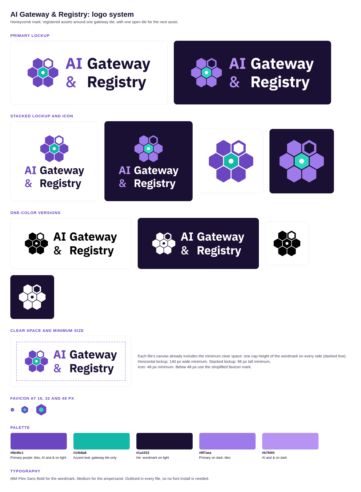

# AI Gateway & Registry logo



The mark is a honeycomb. The purple tiles stand for registered assets (MCP servers, agents, skills), the teal center tile stands for the gateway, and the open top-right tile leaves room for the next asset. The wordmark is IBM Plex Sans Bold, with Medium for the ampersand.

Every SVG has its text converted to outlines, so the files render the same on machines without the font. IBM Plex Sans is licensed under the [SIL Open Font License](https://github.com/IBM/plex/blob/master/LICENSE.txt).

## Which file to use

| Use | File |
| --- | --- |
| Docs and slide title on a light background | `svg/lockup-horizontal-on-light.svg` |
| The same on a dark background | `svg/lockup-horizontal-on-dark.svg` |
| Repo README and the GitHub Pages site | `png/lockup-horizontal-on-light.png`, `png/lockup-horizontal-on-dark.png`, with `png/lockup-horizontal-neutral.png` as the fallback |
| Square or tall spaces (social cards, posters) | `svg/lockup-stacked-on-light.svg`, `svg/lockup-stacked-on-dark.svg` |
| App header next to live title text, avatars, slide footers | `svg/icon-on-light.svg`, `svg/icon-on-dark.svg` |
| Print, embroidery, partner slides with one ink | `svg/*-mono-black.svg`, `svg/*-mono-white.svg` |
| Browser tab | `favicon.ico`, `svg/favicon.svg` |
| iOS home screen | `png/favicon-180.png` |

Each SVG has a matching PNG in `png/`, rendered at twice the SVG's pixel size. Prefer the SVG wherever the tool accepts it.

The `on-dark` files have white or light text on a transparent background, so they disappear on a white page. On GitHub, wrap the horizontal lockups in a `<picture>` element so each theme gets the right one. The repo README does this:

```html
<picture>
  <source media="(prefers-color-scheme: dark)" srcset="docs/logo/png/lockup-horizontal-on-dark.png">
  <source media="(prefers-color-scheme: light)" srcset="docs/logo/png/lockup-horizontal-on-light.png">
  
</picture>
```

GitHub picks one of the two theme sources. Some renderers ignore them and always load the ``, including the VS Code Markdown preview, PyPI and npm. `lockup-horizontal-neutral` uses mid-tone purple and teal that read on both white and dark backgrounds, so it is the safe fallback.

The README uses the PNGs because `scripts/build_landing_page.py` turns the README into the GitHub Pages site and loads its images from `raw.githubusercontent.com`. That host serves SVG files as plain text, so browsers will not draw them there.

## Rules

- Keep clear space of one cap height of the wordmark on every side. The canvas of every lockup file already includes it.
- Show the horizontal lockup at least 140 px wide and the stacked lockup at least 96 px tall.
- Show the icon at 48 px or larger. Below 48 px, use the favicon mark (one purple tile holding the teal tile).
- Do not recolor, stretch, rotate or add effects to the mark. Do not apply a CSS filter that turns it white; use the `on-dark` or `mono-white` file instead.

## Palette

| Color | Hex | Use |
| --- | --- | --- |
| Primary purple | `#6b46c1` | Tiles, "AI" and "&" on light backgrounds |
| Accent teal | `#14b8a6` | Gateway tile on light backgrounds |
| Ink | `#1a1033` | Wordmark on light backgrounds |
| Purple on dark | `#9f7aea` | Tiles on dark backgrounds |
| Light purple on dark | `#b794f4` | "AI" and "&" on dark backgrounds |
| Teal on dark | `#2dd4bf` | Gateway tile on dark backgrounds, favicon |
